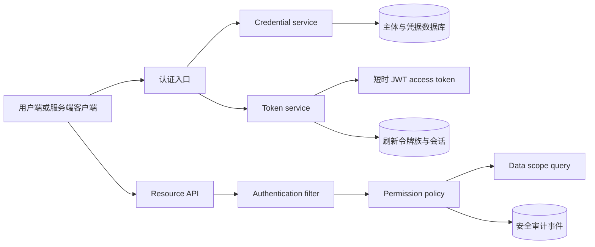

# Keystone Native 鉴权与授权产品计划

## 术语与边界

- **认证（Authentication）**：确认用户或机器凭据属于哪个主体。
- **授权（Authorization）**：根据主体、凭据范围、资源和动作决定是否允许操作。
- **用户会话（User session）**：用户登录后使用短时访问令牌和轮换刷新令牌。
- **API Key**：机器调用凭据。只保存哈希，支持范围、过期和撤销。
- **角色（Role）**：权限的管理分组。角色本身不直接代表数据范围。
- **权限（Permission）**：稳定的 `resource:action` 操作标识。
- **数据范围（Data scope）**：主体可以读取或修改哪些资源记录。

## 重构前基线证据

现有代码使用 `@RolesAllowed("ADMIN")` 和 `@RolesAllowed({"USER", "ADMIN"})` 保护接口。`sys_permission` 主要用于菜单和角色展示，接口没有统一按权限码核验。`sys_role.data_scope` 与 `dept_scope` 已存在，但没有进入业务查询条件。

现有访问令牌有效期为两小时。令牌只包含用户名、用户 ID、角色和 `jti`，没有明确的 `aud`、`sid` 和权限范围。刷新令牌、访问令牌标识和会话状态共用 `sys_refresh_token`。登出接口允许匿名调用，并以请求体中的刷新令牌作为唯一输入。登录没有失败次数、账户锁定、MFA 或请求限流。

## 当前实现证据

截至当前分支实现，受保护资源已经使用 `@RequiresPermission` 和集中授权服务。用户接口已接入 `ALL`、`SELF`、`DEPARTMENT`、`DEPARTMENT_AND_CHILDREN`、`CUSTOM` 范围策略。API Key 已接入 Quarkus `HttpAuthenticationMechanism`，支持服务主体、范围交集、轮换、撤销、过期和最后使用时间节流。数据访问层已开始迁移到 Hibernate ORM with Panache；安全事件、操作日志、登录和 API Key 限流记录以及用户登录认证已使用 ORM Repository，其他旧 Repository 仍待迁移。

当前会话状态保存在 `sys_auth_session`，刷新令牌保留在 `sys_refresh_token` 作为轮换明细。访问令牌有效期为五分钟，并校验 `iss`、`sub`、`aud`、`jti`、`sid`、`iat`、`exp` 和 `permission_version`。权限版本变化、密码变更、用户禁用和会话撤销都会使受影响的访问令牌失效。

令牌签发失败时，登录和 MFA 登录会撤销刚创建的会话；刷新失败时会撤销刚轮换的会话，避免数据库中保留客户端无法使用的刷新状态。签名密钥配置错误仍应在启动或就绪检查阶段被发现。

当前新增了 MFA 第一版运行链路：`V39__mfa_foundation.sql` 建立 TOTP、恢复码和认证挑战数据表，`V40__mfa_permissions.sql` 建立 `mfa:manage` 权限；`TotpService` 实现 RFC 6238 六位验证码、三步时钟窗口和时间步返回，`MfaSecretCipher` 使用 AES-256-GCM 保护 TOTP 密钥，`MfaRecoveryCodeService` 使用部署级 pepper 计算恢复码 HMAC，`MfaChallengeRepository`、`MfaSessionRepository` 和 `MfaRepository` 分别处理挑战、会话认证强度、密文状态和一次性消费条件，`MfaService` 编排 enrollment、登录挑战、恢复码和强制 MFA 策略。

现代和兼容登录入口在密码正确且用户要求 MFA 时返回 `MFA_REQUIRED` 和不透明挑战 ID，不创建会话或令牌；`POST /api/v1/auth/mfa/verify` 校验 TOTP 或恢复码后才创建会话和令牌。`POST /api/v1/auth/mfa/enroll`、`POST /api/v1/auth/mfa/enroll/verify` 提供管理员 enrollment，`PUT /api/v1/auth/mfa/policy/{userId}` 只允许对已完成 enrollment 的用户启用策略。API Key 被拒绝进入这些人类 MFA 路径。恢复码只在 enrollment 成功响应中返回一次，数据库保存 HMAC，不保存恢复码明文。

上述 MFA 代码已通过全量主源码和测试源码静态 `javac`，并通过固定向量和输入边界 smoke 检查。MFA 失败现在按主体和来源地址双维度限流，API Key、角色、用户、在线会话和 MFA enrollment/策略管理的敏感写操作已接入最近十分钟 AAL2 step-up 检查，恢复码轮换还要求当前密码。密码强度和账户锁定指数退避已接入用户创建及密码修改路径。JWT 不再使用仓库内公钥 fallback，签发必须配置外部密钥和 `JWT_KEY_ID`，访问令牌写入 `kid`。`GET /api/.well-known/jwks.json` 已发布当前 RSA 公钥，旧的 `GET /login/rsa-public-key` 兼容路由也改为读取相同的外部公钥配置；当前实现支持通过 `JWT_JWK_KEYS` 发布多个重叠公钥，并在启用多 key 时要求 `JWT_VERIFY_PUBLIC_KEY_LOCATION` 指向 JWK Set 文件或 HTTPS JWK Set URL。

当前验证边界仍然明确：静态主源码和测试源码编译、JWK 字段与缓存 smoke、MFA 聚合方法边界测试、可信代理解析 smoke 和差异检查已通过；Quarkus HTTP、MySQL 8.4 迁移、并发 TOTP/恢复码消费、真实浏览器验收仍未完成。MFA enrollment、TOTP、恢复码和挑战消费已经使用单数据库事务；成功后的限流清理采用提交后尽力处理，清理失败只记录不改变成功响应。`TRUSTED_PROXY_CIDRS` 为空时忽略 `X-Forwarded-For`，仅在 TCP 远端属于配置网段且转发链合法时使用原始客户端地址。账户锁定的行锁更新、登录限流首次创建记录的唯一键竞争仍需 MySQL 8.4 并发验收，不能把静态事务代码当作并发证明。`@Context RoutingContext` 的真实 HTTP 注入、数据库故障回滚和代理链部署验收仍未完成。OIDC、WebAuthn、密钥重叠轮换、跨租户边界和全资源数据范围仍未完成。

## 目标架构

认证入口只接受登录密码、刷新令牌和 `API_KEY` 三类凭据。用户访问令牌使用 RS256、五至十分钟有效期、`iss/sub/aud/jti/sid/iat/exp/scope` 标准声明。刷新令牌每次使用都轮换；重复使用旧令牌时撤销整个令牌族。密码变更、禁用用户、注销会话和权限版本变化都能使现有会话失效。

API Key 使用 `ks_live_<prefix>_<secret>` 格式。数据库只保存 SHA-256 哈希和前缀。明文只在签发响应中返回一次。每个 key 具有主体、名称、显式权限范围、创建者、过期时间、撤销时间和最后使用时间。API Key 默认通过 `Authorization: ApiKey <value>` 发送，服务端不把它转换成用户密码或刷新令牌。

授权分三层：接口层核验权限码，服务层核验资源动作，查询层追加数据范围条件。所有拒绝都记录主体、凭据类型、权限码、资源和结果；日志不记录令牌、密码或完整 API Key。

## 分阶段交付

| 阶段 | 交付 | 验收条件 |
| --- | --- | --- |
| P0 | 凭据边界、API Key 生命周期、失败限流和管理员 MFA 基线 | 无越权签发；明文只返回一次；撤销、过期和锁定立即生效 |
| P1 | 会话表与刷新令牌族、短时 JWT、登出和密码变更失效 | 轮换并发只能成功一次；旧令牌重用会撤销令牌族 |
| P2 | `resource:action` 权限拦截器和权限缓存失效 | 未授权返回 403；权限变更在一个请求周期内生效 |
| P3 | OIDC、WebAuthn、密钥轮换和 JWK 发布 | step-up 覆盖全部敏感操作；OIDC 使用 PKCE；公钥可轮换 |
| P4 | 安全运营与下线旧接口 | 事件、告警、恢复演练完成；旧接口和旧 token 字段已删除 |

## 产品接口草案

### 用户认证

- `POST /api/v1/auth/login`：输入用户名、密码、客户端标识和设备信息。成功返回 `accessToken`、`refreshToken`、`tokenType`、`expiresIn`、`refreshExpiresIn`、`sessionId` 和 `subject`。
- `POST /api/v1/auth/refresh`：只接受当前刷新令牌。成功后旧令牌立即失效并返回新令牌；旧令牌重用返回 `401`，并撤销同一令牌族。
- `POST /api/v1/auth/logout`：必须使用当前访问令牌。默认撤销当前会话；`all=true` 需要更高权限并撤销主体的全部会话。
- `POST /api/v1/auth/password`：需要当前密码或已验证的 MFA。成功后增加 `credential_version`，撤销全部会话和 API Key。
- `GET /api/v1/auth/sessions`、`DELETE /api/v1/auth/sessions/{id}`：查询和撤销当前主体的会话。管理员可以按主体查询，但必须记录审计事件。

### API Key

- `POST /api/v1/api-keys`：管理员或具有 `api-key:create` 权限的主体签发。请求包括 `name`、`scopes`、`expiresAt` 和可选的 `subjectId`。
- `GET /api/v1/api-keys`：只返回 ID、前缀、名称、范围、状态、创建时间、过期时间和最后使用时间。
- `DELETE /api/v1/api-keys/{id}`：撤销 key。撤销操作幂等，并记录创建者和操作者。
- 调用格式为 `Authorization: ApiKey <key>`。`<key>` 只在创建响应中返回一次。

### 授权

权限码采用小写的 `resource:action` 格式，例如 `user:read`、`user:write`、`session:revoke`、`api-key:create`。角色只绑定权限集合。接口、服务和数据查询使用同一个权限码；菜单只引用权限码，不参与安全判定。

### JWT 公钥发现

- `GET /api/.well-known/jwks.json`：公开返回当前外部 RSA 公钥的 RFC 7517 JWK Set。响应只包含 `kty`、`kid`、`alg`、`use`、`n` 和 `e`，公钥读取失败返回 `503`。缺少或非法的 `JWT_KEY_ID` 属于启动配置错误，应用应在就绪检查中失败。
- 当前实现默认发布一个配置 key，也支持通过 `JWT_JWK_KEYS` 以 `kid=location;kid=location` 配置多个重叠公钥，并使用 `JWT_JWK_CACHE_SECONDS` 控制 1 至 3600 秒的已校验快照缓存。启用多个 key 时，`JWT_VERIFY_PUBLIC_KEY_LOCATION` 必须指向包含全部公钥的 JWK Set 文件或 HTTPS JWK Set URL；继续使用单个 PEM 会在启动检查阶段失败。缓存过期后的读取、解析和 JWK 组装全部成功时才替换快照；失败时继续提供上一个有效快照，直到缓存过期后请求失败。持久化 key registry、旧 key 到期清理和旧 key HTTP 验收仍需后续实现。
- 兼容客户端仍可调用 `GET /login/rsa-public-key`，但该接口读取同一个外部公钥位置，不再读取仓库内资源。

## 数据模型变更

### 数据访问层选择

当前项目选择 **Quarkus Hibernate ORM with Panache**，采用 `PanacheRepository<Entity>` 模式。该模式基于 Hibernate ORM/JPA，保留实体与 Repository 的职责分离，适合现有 Quarkus CDI、MySQL、事务和 Native 构建环境。项目不引入 MyBatis，也不采用 Panache Active Record 模式。

Flyway 继续负责数据库结构迁移，Hibernate ORM 设置为不自动创建或修改表结构。新增业务数据访问代码不得直接注入 `DataSource`、拼接 SQL 或使用 `PreparedStatement`。只有 Flyway 迁移文件和经过单独记录的数据库特定并发操作可以保留原生 SQL。

第一阶段已将 `sys_security_event` 迁移到 `SecurityEventEntity` 和 `SecurityEventRepository`；操作日志已使用 `OperationLogEntity` 和 `OperationLogRepository`，登录、API Key 和 MFA 限流已分别使用 `LoginRateLimitEntity`、`ApiKeyRateLimitEntity`、`MfaRateLimitEntity` 及对应的 Panache Repository，API Key 主记录已使用 `ApiKeyEntity`、`ServiceSubjectEntity` 和对应的 Panache Repository，API Key 认证和签发权限读取已使用独立的用户、角色和权限 ORM 映射，会话已使用 `AuthSessionEntity`、`RefreshTokenEntity`、`RefreshTokenEventEntity` 和对应的 Panache Repository，MFA 会话状态已复用 `AuthSessionEntity`，用户认证、失败登录锁定、独立密码修改、权限读取、权限版本和登录元数据已使用 ORM 用户 Repository。用户资料和角色综合更新、CRUD、范围查询，MFA 认证请求和 MFA 凭据 Repository 以及其他旧 Repository 仍使用 JDBC，后续按安全边界和事务复杂度分批迁移。迁移期间不得在同一业务职责中新增两套持久化实现。

当前已新增 `sys_api_key`、`sys_auth_session`、MFA 基础表和相关用户字段。后续仍需要补充以下表或字段：

- `sys_auth_session`：当前实现包含 `id`、`user_id`、`client_id`、`approved_scope`、`refresh_family_id`、`refresh_expires_at`、`idle_expires_at`、`last_seen_at`、`revoked_at`、`mfa_verified_at`、`mfa_assurance` 和 `mfa_amr`；IP、User-Agent 摘要和设备名称仍待补充。
- `sys_refresh_token_event`：记录轮换、重用、撤销和失败原因，用于检测令牌族攻击。
- `sys_user.mfa_required` 和 `mfa_grace_until`：用于记录 MFA 强制策略和宽限期，当前仍待补充。
- `sys_mfa_rate_limit`：只保存主体和来源地址的哈希维度、窗口计数和阻断时间；V41 使用可重跑建表迁移。
- `sys_permission.effect` 和 `sys_subject_permission`：为显式拒绝和主体级例外留下边界；默认拒绝，显式拒绝优先于允许。
- `sys_security_event`：统一安全事件，替代登录日志和操作日志中重复的安全字段。

还需要增加 `sys_service_subject`、`sys_auth_client` 和 `sys_api_key_scope` 或等效的规范化关系。若第一版保持单租户，仍需在授权接口和数据访问层定义租户边界，避免后续直接复用用户 ID 作为跨租户隔离条件。

所有令牌哈希列建立唯一索引。状态变更和轮换在同一个数据库事务中完成，并使用行锁防止并发刷新成功两次。

## 实施任务清单

### P0：凭据基础（当前批次）

- [x] 建立 `sys_api_key` 迁移。
- [x] 生成高熵随机 API Key，只保存 SHA-256 哈希。
- [x] 返回一次明文、支持过期和撤销、更新最后使用时间。
- [x] 增加 `Authorization: ApiKey` 请求入口。
- [x] 将 API Key 身份接入 Quarkus `HttpAuthenticationMechanism`，避免只依赖 JAX-RS `SecurityContext`。
- [x] 增加服务主体和签发者范围模型，禁止用角色名称充当 scope。
- [x] 增加 API Key 列表、轮换、幂等撤销、过期上限和使用时间更新限速。
- [x] 按 IP 和用户名双维度限制登录失败请求，并在成功登录后清除计数。
- [x] 增加 API Key 按权限码的接口测试和日志脱敏测试用例；Quarkus/MySQL 运行验收仍待执行。
- [x] 增加失败登录、账户锁定指数退避、管理员 MFA 第一版运行边界和 MFA 主体/IP 双维度限流；API Key 猜测专项和生产运行验收仍待执行。

当前已增加密码策略、第五次失败起指数账户锁定、成功登录清零失败计数、密码更新重置锁定状态并递增 `credential_version`，并在现代和兼容登录入口增加数据库限流。API Key 认证失败现在按来源地址和凭据摘要双维度限流，失败窗口只保存哈希键；成功认证只清理当前凭据桶，来源地址桶保留到窗口结束。`sys_security_event` 已统一记录 API Key 认证结果和权限拒绝结果，并保存非秘密 `credential_id` 和来源地址，事件不保存令牌、密码或完整 API Key。管理员 MFA 已完成第一版 TOTP enrollment、登录挑战、恢复码、策略开关和主体/IP 双维度失败限流；生产运行验收仍未完成。

当前代码已完成 API Key 的统一 Quarkus 身份入口、服务主体回填、scope 格式和签发者权限交集、元数据列表、轮换、幂等撤销、操作日志记录和 `last_used_at` 最小更新间隔。P0 仍未完成 API Key 猜测专项验收、完整 HTTP 接口运行验收和 MySQL 并发验收，因此不能标记为完成。

### P1：用户会话

- [x] 在刷新令牌表增加 `session_id`、`refresh_family_id`、客户端标识和空闲期限。
- [x] 增加 `sys_auth_session` 并把创建、轮换、撤销和访问令牌校验接入独立会话状态。
- [x] 使用 `sid`、`sub` 和 `aud` 发行五分钟 JWT。
- [x] 保持刷新令牌族绝对到期时间，并在重用时撤销整族。
- [x] 将刷新令牌绑定到客户端。
- [x] 将刷新令牌绑定到已批准的 scope/resource。
- [x] 增加失败计数和账户锁定。
- [x] 增加密码强度和指数退避。
- [x] 密码变更和禁用用户触发会话撤销。
- [x] 权限变更触发会话或权限版本失效。

P1 当前实现已完成独立会话状态、会话 ID、令牌族、空闲期限、绝对刷新期限、旧令牌重用撤销、刷新事件记录、五分钟访问令牌、客户端绑定、批准范围绑定、权限版本校验以及 `sub/aud/sid/jti` 声明。缺少 `jti` 的 JWT 现在会直接返回 `401`，访问令牌还必须对应活动会话。并发 MySQL 验收仍未完成。

### P2：权限和数据范围

- [x] 新增 `@RequiresPermission` 拦截器和集中式 `AuthorizationService`，并迁移 API Key 管理接口。
- [x] 把现有 `@RolesAllowed` 替换为权限码；角色只作为权限集合管理。
- [x] 迁移用户管理和角色管理接口到权限码。
- [x] 迁移在线会话和操作审计接口到权限码。
- [x] 把 `data_scope` 转为明确策略：`ALL`、`SELF`、`DEPARTMENT`、`DEPARTMENT_AND_CHILDREN`、`CUSTOM`。
- [ ] 将同一范围策略推广到所有资源、导出、批量操作和异步任务。
- [ ] 每个列表、详情、更新和删除接口补充跨部门越权测试。

当前已增加统一 `DataScopeService`，并把现代用户接口和用户兼容接口的列表、详情、更新、密码、状态、删除、批量删除、导出和导入路径接入范围条件。普通用户的默认角色范围在 `V31__default_user_data_scope.sql` 中收紧为 `SELF`。部门树递归和 `CUSTOM` 部门 ID 已进入查询条件；部门列表和下拉接口现在按 `ALL`、`SELF`、`DEPARTMENT`、`DEPARTMENT_AND_CHILDREN` 和 `CUSTOM` 过滤。岗位资源没有 `dept_id`，因此暂不接入范围过滤；其他资源、异步任务和跨部门集成测试仍未完成。
核心资源和兼容路由的权限码迁移已覆盖用户、角色、会话、审计、部门、字典、岗位、配置、菜单、任务、文件、个人资料、通知、旧认证和日志资源。受保护资源已不再使用 `@RolesAllowed`；公开健康检查、验证码和公告列表继续使用 `@PermitAll`。授权决策和访问令牌签发的主体权限读取已使用 ORM 用户、角色和权限映射。权限缓存失效、显式拒绝和跨租户范围仍未完成。

### P3：多因素和外部身份

- [x] 完成管理员 TOTP 第一版：enrollment、登录挑战、恢复码一次性消费、会话认证强度和强制策略开关。
- [x] 将 step-up 接入 API Key、角色、用户、会话和 MFA enrollment/策略管理敏感写操作。
- [x] 提供当前密码加 step-up 保护的恢复码独立轮换接口。
- [x] 要求外部 JWT 公钥和 `kid` 密钥标识，删除仓库内生产公钥 fallback。
- [ ] 增加 OIDC 授权码 + PKCE；校验 `state`、`nonce`、issuer、audience 和时间窗口。
- [x] 发布 JWK Set，使用外部 RSA 公钥和 `kid`，公钥不可用时返回 `503`。
- [x] 增加 `JWT_JWK_KEYS` 多 key JWK 发布和启动位置检查；启用多 key 时必须配置真正的 JWK Set 文件或 HTTPS JWK URL，key registry、旧 key 到期清理和旧 key HTTP 验收仍未完成。

#### 管理员 TOTP 第一版实现和限制

当前第一版实现管理员 TOTP、一次性恢复码和登录挑战。API Key 不参与人类用户 MFA。WebAuthn 作为后续更强的抗钓鱼方案。API Key、角色、用户、在线会话和 MFA enrollment/策略管理敏感写操作已经接入 step-up；恢复码轮换还要求当前密码，并在数据库事务内替换旧批次。

已追加 `V39__mfa_foundation.sql` 和 `V40__mfa_permissions.sql`，没有修改已执行迁移：

- `sys_user_mfa` 保存 `user_id`、TOTP 密文、随机 nonce、`key_version`、启用时间、失败计数、锁定时间和最近成功的时间步。TOTP 密钥使用 AES-256-GCM 加密；首版若不能接入 KMS，必须配置 32 字节 `MFA_MASTER_KEY`，并记录密钥版本和重新加密流程。
- `sys_mfa_recovery_code` 保存恢复码哈希、批次和消费时间。生成至少十个高熵恢复码，只在生成响应中显示一次。消费使用行锁和条件更新，保证并发请求只能成功一次。
- `sys_auth_challenge` 保存不透明挑战 ID、主体、用途、客户端、过期时间、尝试次数和消费时间。挑战有效期建议五分钟，只绑定密码已验证的主体和客户端，不保存密码、TOTP 明文或完整恢复码。
- `sys_auth_session` 增加 `mfa_verified_at` 和认证强度字段。现有用户默认不启用 MFA；迁移不能直接把 `admin` 设置为必须 MFA。

实现组件和接口顺序如下：

1. `MfaSecretCipher` 使用 AES-256-GCM 保存 TOTP 密文，密钥版本由配置提供；未配置主密钥时只在实际使用密文时失败。
2. `POST /v1/auth/mfa/enroll` 创建短期 enrollment 挑战并返回一次性 TOTP 配置材料。
3. `POST /v1/auth/mfa/enroll/verify` 校验 TOTP 后启用 MFA，并返回一次性恢复码列表。
4. 密码正确且用户要求 MFA 时，`POST /v1/auth/login` 和兼容登录入口只返回 `MFA_REQUIRED` 和不透明挑战 ID，不签发会话或令牌。
5. `POST /v1/auth/mfa/verify` 校验 TOTP 或恢复码后，才创建 `sys_auth_session`、刷新令牌和访问令牌，并写入 `mfa_verified_at`、认证强度和 `amr`。
6. `PUT /v1/auth/mfa/policy/{userId}` 只允许对已经完成 enrollment 的用户启用强制 MFA，并在策略变化后撤销该用户的会话。
7. API Key 被 `RejectApiKey` 拦截器拒绝进入登录、enrollment、MFA 验证和策略管理路径。

TOTP 使用 RFC 6238 的 30 秒时间步、六位数字和允许前后一个时间步的时钟偏差。相同时间步的重复使用必须失败。当前失败次数按主体和来源地址双维度计数并短时锁定；数据库只保存哈希后的维度键。密码变更、用户禁用、会话撤销和重新 enrollment 必须撤销相关挑战。

API Key、角色、用户、在线会话、MFA enrollment/策略变更和恢复码轮换均已接入 step-up。恢复码轮换还必须提供当前密码。API Key 不能执行这些人类用户 MFA 管理路径。

实现验收必须证明：未完成 enrollment 的用户不获得强制 MFA 令牌；正确 TOTP 才能创建会话；错误、过期、错误客户端和重复挑战统一失败；恢复码只能消费一次；同一时间步并发请求只有一次成功；密钥、恢复码和完整 `otpauth` 数据不出现在日志、错误响应或数据库明文。当前已完成单事务代码、静态编译、固定向量和输入边界 smoke；MySQL 8.4 迁移、并发消费、故障回滚和真实 HTTP 运行验收仍未完成，因此 MFA 不能标记为生产完成。

### P4：运营与发布

- [ ] 增加安全事件指标、异常登录告警、API Key 轮换报告、事件容量限制和保留清理。
- [ ] 进行 MySQL 8.4 并发刷新、故障恢复、备份还原和密钥轮换演练。
- [x] 完成 MFA 因子消费的单事务实现，覆盖 enrollment、TOTP、恢复码和挑战状态；MySQL 并发与故障验收仍待执行。
- [x] 完成可信代理地址解析，默认使用连接远端地址，拒绝未验证的 `X-Forwarded-For` 链；真实 HTTP 注入和部署链验收仍待执行。
- [x] 增加 `JWT_KEY_ID`、签名私钥和公钥集合的启动检查；Quarkus 就绪状态和运行时签名错误验收仍待执行。
- [ ] 删除旧根路由、旧 token 字段、旧兼容资源和无效测试。

## 迁移与回滚边界

用户已允许破坏性更新，因此 P1 开始可以删除旧的根路由和兼容资源。数据库迁移仍按 Flyway 版本追加。发布前备份用户和角色数据；若新认证链路验收失败，回滚应用版本并保留迁移后的新表，禁止直接修改已执行迁移。

## 发布前检查

- `./gradlew test` 使用 MySQL 8.4 实例运行。
- `./gradlew quarkusBuild -x test` 成功。
- 运行 API Key 的签发、使用、过期、撤销、权限不足和日志脱敏测试。
- 使用真实 HTTP 窗口验证登录、注销和密钥管理页面；无真实窗口时明确记录限制。

## 设计审查结论

本设计可以作为重构方向，但当前版本还不能直接作为生产发布方案。目标架构的主线是合理的：短时访问令牌、刷新令牌轮换、API Key 哈希存储、权限码和数据范围分层。主体模型、客户端边界、权限继承规则和失败处理已经写入本文档；MySQL、并发和真实 HTTP 运行证据仍不完整。

设计等级：**有条件通过设计评审，禁止按当前文档直接发布**。P0、P1 和 P2 的阻塞项关闭后，再进入实现评审和发布前安全评审。

阻塞项如下：

1. 必须把人类用户、服务主体、API Key 和 OAuth 客户端分开建模。API Key 不能因为携带 `ADMIN` 字符串而获得管理员角色。
2. 必须使用 Quarkus 的 `HttpAuthenticationMechanism` 或等效的安全身份提供器接入 API Key。仅设置 JAX-RS `SecurityContext` 会让 REST 层和 Quarkus `SecurityIdentity` 的行为依赖执行顺序。
3. 必须先完成刷新令牌族的并发控制、重用检测和客户端绑定，再缩短 JWT 生命周期。只缩短访问令牌不能消除刷新令牌被窃取后的持续访问风险。
4. 必须保留登录失败计数、账户锁定、请求限流和管理员 MFA 第一版，并完成 MySQL 与真实 HTTP 运行验收。
5. 必须把权限码落实到每个接口、服务方法和查询条件。现有 `@RolesAllowed("ADMIN")` 仍然是角色级控制，不能作为新模型的验收证据。
6. 必须继续补齐 API Key 的过期、审计和并发运行测试；列出、轮换、范围上限和一次性明文已经有实现与静态接口测试。
7. 必须在受信反向代理配置明确后才启用 `X-Forwarded-For` 的 MFA 来源限流；部署直接暴露应用端口时，应使用连接远端地址，并对无法解析的地址采用独立、可观测的处理策略。
8. enrollment、恢复码批次替换、TOTP 接受和挑战消费已经放入同一事务；仍必须完成 MySQL 并发和故障注入验收，证明失败时不会留下部分状态。
9. `JWT_KEY_ID`、签名私钥和公钥位置已经接入启动检查；仍必须通过 Quarkus 启动和就绪验收，证明配置错误不会创建不可用会话或轮换出客户端无法使用的新刷新令牌。

## 必须先确定的架构决策

### 主体和客户端

系统至少包含两类主体：人类用户和服务主体。服务主体没有交互式密码，不继承某个管理员用户的会话。每个 API Key 必须归属于一个服务主体；如果第一版暂时不引入独立服务主体，必须明确记录 `subject_type=USER`，并禁止 API Key 执行密码修改、MFA 修改、主体删除和 API Key 管理操作。

客户端分为浏览器客户端、受控后端客户端和内部任务客户端。浏览器客户端使用后端会话或 OAuth 授权码 + PKCE。外部客户端不使用用户名密码直接换取令牌。受控后端客户端使用 API Key、私钥 JWT 或 mTLS；选择哪一种由部署边界和密钥保管能力决定。

请求只允许一种认证凭据。服务端拒绝同时出现 `Bearer`、`ApiKey`、Cookie 或其他认证头的请求。令牌不能放在 URL 查询参数、日志字段或重定向地址中。生产环境强制 HTTPS，并设置安全的 CORS、缓存和响应头策略。

### 用户访问令牌

`sub` 使用稳定的主体 ID。`upn` 只作为显示或兼容字段。资源服务必须同时校验 `iss`、`aud`、`exp`、`iat`、`jti`、令牌类型和签名算法。访问令牌头部使用 `kid`；密钥轮换期间保留旧公钥到所有旧令牌过期。

建议的令牌配置为：访问令牌 5 分钟，刷新令牌绝对期限 14 天，非活动期限 24 小时。`scope` 是权限码的空格分隔集合；角色不直接放入资源服务的授权判断。需要实时撤销时，通过 `sid`、主体凭据版本和短 TTL 缓存核验会话状态。

### API Key

API Key 的有效权限为：`请求范围 ∩ 签发者可授予范围 ∩ 主体当前权限`。服务端拒绝未知权限、管理员角色名称和超出签发者权限的范围。角色名不能作为 API Key scope。

每个 key 保存 `id`、`subject_id`、`created_by`、`name`、`prefix`、`secret_hash`、`scopes`、`created_at`、`expires_at`、`last_used_at`、`revoked_at`、`rotated_to` 和撤销原因。明文只返回一次。签发接口必须校验最长期限、范围数量、范围长度和名称长度。必须支持列出元数据、立即撤销、主动轮换和短暂重叠期；轮换后旧 key 只允许在明确的宽限时间内使用。

API Key 认证成功后创建统一的 `SecurityIdentity`，身份属性必须包括主体 ID、凭据 ID、凭据类型、权限范围和会话状态。认证失败统一返回 `401`，权限不足返回 `403`。`last_used_at` 应使用可配置的最小更新间隔或异步聚合，避免每个请求都写数据库。

### 授权决策

授权服务使用默认拒绝策略。决策输入为主体、凭据、权限码、动作、资源 ID、租户 ID 和请求上下文。权限来自角色绑定、主体直接授权和 API Key scope；显式拒绝优先于允许。授权服务不能根据前端菜单、URL 名称或用户提交的角色字符串做决定。

数据范围必须在数据访问层落实。每个列表、详情、更新、删除、导出、批量操作和异步任务都必须调用同一个范围构造器。单租户部署也应在模型中保留 `tenant_id` 的边界，否则未来多租户迁移会扩大越权风险。

### 故障处理

认证数据库不可用、权限查询超时、缓存状态不确定或密钥状态无法确认时，受保护请求必须失败关闭并返回统一的 `503` 或 `401`，不能回退到 JWT 中的旧角色或前端传入的权限。健康检查和就绪检查要分别报告数据库、迁移、签名私钥和公钥集合状态。

## 完备性验收矩阵

| 领域 | 必须证明的行为 | 当前状态 |
| --- | --- | --- |
| 密码认证 | 弱密码拒绝、失败退避、账户锁定、用户枚举防护、密码变更撤销会话 | 部分完成：密码策略和指数退避已实现，用户枚举防护及运行验收未完成 |
| JWT | `iss/aud/sub/jti/sid/iat/exp/kid` 校验、算法白名单、时钟偏差、密钥轮换 | 部分完成：外部公钥、`kid` 和多 key JWK 发布已实现，SmallRye 多 key 验证、key registry、JSON HTTP 验收及运行验收未完成 |
| 刷新令牌 | 原子轮换、并发单成功、重用检测、整族撤销、客户端绑定、空闲过期 | 部分完成：会话状态和主路径已实现，并发 MySQL 验收未完成 |
| API Key | 服务主体、范围交集、一次性明文、过期、撤销、轮换、审计、限速 | 部分完成 |
| 授权 | 默认拒绝、权限码、显式拒绝、实时失效、服务层和查询层复核 | 部分完成：权限码和权限版本失效已实现，显式拒绝及全量服务层复核未完成 |
| 数据范围 | SELF、DEPARTMENT、子部门、CUSTOM、导出和批量操作无越权 | 部分完成：用户资源已接入，其他资源和运行验收未完成 |
| MFA | 管理员强制 MFA、恢复码、重新验证和敏感操作升级认证 | 部分完成：TOTP enrollment、登录挑战、恢复码、策略开关、主体/IP 限流、敏感写操作 step-up、恢复码轮换和因子单事务消费已实现；MySQL 并发、故障回滚和 HTTP 运行验收未完成 |
| Web 与传输 | HTTPS、CORS、CSRF、Cookie 属性、浏览器存储、缓存控制 | 未完成 |
| 审计 | 签发、使用、失败、撤销、重用、权限拒绝和管理员操作可追踪 | 部分完成：API Key 认证、权限拒绝和非秘密 credential ID 已记录；保留清理、容量控制、完整凭据生命周期和运行验收未完成 |
| 运维 | 密钥托管、轮换、备份恢复、告警、限流、数据库故障行为 | 未完成 |
| 兼容清理 | 旧根路由、旧 token 字段、旧测试和文档全部删除或明确下线 | 部分完成：旧 RSA 公钥路由已改用外部配置，其他兼容入口仍待清理 |

## 审查后的阶段调整

原计划中的 MFA、限流和 API Key 完整生命周期排得过晚。调整为：P0 完成主体边界、API Key 安全基线、登录失败防护和管理员 MFA；P1 完成会话与刷新令牌；P2 完成权限码和数据范围；P3 完成 OIDC、WebAuthn 和密钥轮换；P4 完成审计、告警、恢复演练和旧接口删除。

P0 代码仍必须补充 API Key 猜测、并发撤销和数据库故障运行测试。`GET /api/v1/api-keys`、主动轮换、幂等撤销、过期时间上限、未知 scope 拒绝、scope 与主体权限交集、服务主体归属、审计事件和日志脱敏已有实现或静态接口测试；运行证据完成前不能标记为 P0 完成。

## 发布前新增检查

- 运行并发刷新、并发撤销、API Key 猜测、权限变更和数据库不可用测试。
- 使用独立测试主体验证跨部门、跨主体、跨租户和服务主体边界。
- 验证所有导出、批量操作、异步任务、文件下载和后台任务都执行数据范围检查。
- 生成安全评审记录，列出每个未完成项的责任人、提交、证据和发布决定。
