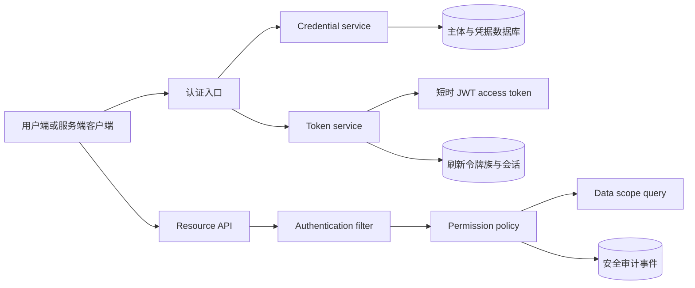

# Keystone Native 鉴权与授权产品计划

## 术语与边界

- **认证（Authentication）**：确认用户或机器凭据属于哪个主体。
- **授权（Authorization）**：根据主体、凭据范围、资源和动作决定是否允许操作。
- **用户会话（User session）**：用户登录后使用短时访问令牌和轮换刷新令牌。
- **API Key**：机器调用凭据。只保存哈希，支持范围、过期和撤销。
- **角色（Role）**：权限的管理分组。角色本身不直接代表数据范围。
- **权限（Permission）**：稳定的 `resource:action` 操作标识。
- **数据范围（Data scope）**：主体可以读取或修改哪些资源记录。

## 当前证据

现有代码使用 `@RolesAllowed("ADMIN")` 和 `@RolesAllowed({"USER", "ADMIN"})` 保护接口。`sys_permission` 主要用于菜单和角色展示，接口没有统一按权限码核验。`sys_role.data_scope` 与 `dept_scope` 已存在，但没有进入业务查询条件。

现有访问令牌有效期为两小时。令牌只包含用户名、用户 ID、角色和 `jti`，没有明确的 `aud`、`sid` 和权限范围。刷新令牌、访问令牌标识和会话状态共用 `sys_refresh_token`。登出接口允许匿名调用，并以请求体中的刷新令牌作为唯一输入。登录没有失败次数、账户锁定、MFA 或请求限流。

## 目标架构

认证入口只接受登录密码、刷新令牌和 `API_KEY` 三类凭据。用户访问令牌使用 RS256、五至十分钟有效期、`iss/sub/aud/jti/sid/iat/exp/scope` 标准声明。刷新令牌每次使用都轮换；重复使用旧令牌时撤销整个令牌族。密码变更、禁用用户、注销会话和权限版本变化都能使现有会话失效。

API Key 使用 `ks_live_<prefix>_<secret>` 格式。数据库只保存 SHA-256 哈希和前缀。明文只在签发响应中返回一次。每个 key 具有主体、名称、显式权限范围、创建者、过期时间、撤销时间和最后使用时间。API Key 默认通过 `Authorization: ApiKey <value>` 发送，服务端不把它转换成用户密码或刷新令牌。

授权分三层：接口层核验权限码，服务层核验资源动作，查询层追加数据范围条件。所有拒绝都记录主体、凭据类型、权限码、资源和结果；日志不记录令牌、密码或完整 API Key。

## 分阶段交付

| 阶段 | 交付 | 验收条件 |
| --- | --- | --- |
| P0 | 新凭据表、API Key 签发/查询/撤销、哈希校验 | 明文只返回一次；撤销和过期立即拒绝；日志无秘密 |
| P1 | 会话表与刷新令牌族、短时 JWT、登出和密码变更失效 | 轮换并发只能成功一次；旧令牌重用会撤销令牌族 |
| P2 | `resource:action` 权限拦截器和权限缓存失效 | 未授权返回 403；权限变更在一个请求周期内生效 |
| P3 | 数据范围策略 | ALL、SELF、DEPARTMENT、CUSTOM 均由 SQL 条件落实并有越权测试 |
| P4 | MFA、OIDC、WebAuthn、密钥轮换和 JWK 发布 | 管理员强制 MFA；OIDC 使用 PKCE；公钥可轮换 |
| P5 | 安全运营 | 失败登录限流、异常刷新告警、凭据轮换报表和备份恢复演练 |

## 产品接口草案

### 用户认证

- `POST /api/v1/auth/login`：输入用户名、密码、客户端标识和设备信息。成功返回 `accessToken`、`refreshToken`、`tokenType`、`expiresIn`、`refreshExpiresIn`、`sessionId` 和 `subject`。
- `POST /api/v1/auth/refresh`：只接受当前刷新令牌。成功后旧令牌立即失效并返回新令牌；旧令牌重用返回 `401`，并撤销同一令牌族。
- `POST /api/v1/auth/logout`：必须使用当前访问令牌。默认撤销当前会话；`all=true` 需要更高权限并撤销主体的全部会话。
- `POST /api/v1/auth/password`：需要当前密码或已验证的 MFA。成功后增加 `credential_version`，撤销全部会话和 API Key。
- `GET /api/v1/auth/sessions`、`DELETE /api/v1/auth/sessions/{id}`：查询和撤销当前主体的会话。管理员可以按主体查询，但必须记录审计事件。

### API Key

- `POST /api/v1/api-keys`：管理员或具有 `api-key:create` 权限的主体签发。请求包括 `name`、`scopes`、`expiresAt` 和可选的 `subjectId`。
- `GET /api/v1/api-keys`：只返回 ID、前缀、名称、范围、状态、创建时间、过期时间和最后使用时间。
- `DELETE /api/v1/api-keys/{id}`：撤销 key。撤销操作幂等，并记录创建者和操作者。
- 调用格式为 `Authorization: ApiKey <key>`。`<key>` 只在创建响应中返回一次。

### 授权

权限码采用小写的 `resource:action` 格式，例如 `user:read`、`user:write`、`session:revoke`、`api-key:create`。角色只绑定权限集合。接口、服务和数据查询使用同一个权限码；菜单只引用权限码，不参与安全判定。

## 数据模型变更

P0 已新增 `sys_api_key`。P1 继续新增以下表或字段：

- `sys_auth_session`：`id`、`user_id`、`client_id`、`refresh_family_id`、`refresh_token_hash`、`refresh_expires_at`、`last_seen_at`、`revoked_at`、IP、User-Agent 摘要和设备名称。
- `sys_refresh_token_event`：记录轮换、重用、撤销和失败原因，用于检测令牌族攻击。
- `sys_user.credential_version`、`failed_login_count`、`locked_until`、`mfa_required`、`last_password_changed_at`。
- `sys_permission.effect` 和 `sys_subject_permission`：为显式拒绝和主体级例外留下边界；默认拒绝，显式拒绝优先于允许。
- `sys_security_event`：统一安全事件，替代登录日志和操作日志中重复的安全字段。

所有令牌哈希列建立唯一索引。状态变更和轮换在同一个数据库事务中完成，并使用行锁防止并发刷新成功两次。

## 实施任务清单

### P0：凭据基础（当前批次）

- [x] 建立 `sys_api_key` 迁移。
- [x] 生成高熵随机 API Key，只保存 SHA-256 哈希。
- [x] 返回一次明文、支持过期和撤销、更新最后使用时间。
- [x] 增加 `Authorization: ApiKey` 请求入口。
- [ ] 将 API Key 身份接入 Quarkus `HttpAuthenticationMechanism`，避免只依赖 JAX-RS `SecurityContext`。
- [ ] 为 API Key 增加按权限码的接口验收测试和日志脱敏测试。

### P1：用户会话

- [ ] 拆分会话、刷新令牌和访问令牌记录。
- [ ] 使用 `sid` 和 `aud` 发行五至十分钟 JWT。
- [ ] 实现刷新令牌族重用检测和整族撤销。
- [ ] 增加密码强度、失败计数、指数退避和账户锁定。
- [ ] 密码变更、禁用用户和权限变更触发会话撤销。

### P2：权限和数据范围

- [ ] 新增 `@RequiresPermission` 拦截器和集中式 `AuthorizationService`。
- [ ] 把现有 `@RolesAllowed` 替换为权限码；角色只作为权限集合管理。
- [ ] 把 `data_scope` 转为明确策略：`ALL`、`SELF`、`DEPARTMENT`、`DEPARTMENT_AND_CHILDREN`、`CUSTOM`。
- [ ] 每个列表、详情、更新和删除接口补充跨部门越权测试。

### P3：多因素和外部身份

- [ ] 管理员强制 TOTP 或 WebAuthn，恢复码一次性使用并哈希保存。
- [ ] 增加 OIDC 授权码 + PKCE；校验 `state`、`nonce`、issuer、audience 和时间窗口。
- [ ] 发布 JWK Set，支持双 key 重叠轮换和 `kid`。

### P4：运营与发布

- [ ] 增加安全事件指标、异常登录告警和 API Key 轮换报告。
- [ ] 进行 MySQL 8.4 并发刷新、故障恢复、备份还原和密钥轮换演练。
- [ ] 删除旧根路由、旧 token 字段、旧兼容资源和无效测试。

## 迁移与回滚边界

用户已允许破坏性更新，因此 P1 开始可以删除旧的根路由和兼容资源。数据库迁移仍按 Flyway 版本追加。发布前备份用户和角色数据；若新认证链路验收失败，回滚应用版本并保留迁移后的新表，禁止直接修改已执行迁移。

## 发布前检查

- `./gradlew test` 使用 MySQL 8.4 实例运行。
- `./gradlew quarkusBuild -x test` 成功。
- 运行 API Key 的签发、使用、过期、撤销、权限不足和日志脱敏测试。
- 使用真实 HTTP 窗口验证登录、注销和密钥管理页面；无真实窗口时明确记录限制。
