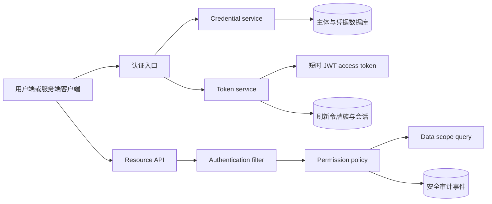

# Keystone Native 鉴权与授权产品计划

## 术语与边界

- **认证（Authentication）**：确认用户或机器凭据属于哪个主体。
- **授权（Authorization）**：根据主体、凭据范围、资源和动作决定是否允许操作。
- **用户会话（User session）**：用户登录后使用短时访问令牌和轮换刷新令牌。
- **API Key**：机器调用凭据。只保存哈希，支持范围、过期和撤销。
- **角色（Role）**：权限的管理分组。角色本身不直接代表数据范围。
- **权限（Permission）**：稳定的 `resource:action` 操作标识。
- **数据范围（Data scope）**：主体可以读取或修改哪些资源记录。

## 重构前基线证据

现有代码使用 `@RolesAllowed("ADMIN")` 和 `@RolesAllowed({"USER", "ADMIN"})` 保护接口。`sys_permission` 主要用于菜单和角色展示，接口没有统一按权限码核验。`sys_role.data_scope` 与 `dept_scope` 已存在，但没有进入业务查询条件。

现有访问令牌有效期为两小时。令牌只包含用户名、用户 ID、角色和 `jti`，没有明确的 `aud`、`sid` 和权限范围。刷新令牌、访问令牌标识和会话状态共用 `sys_refresh_token`。登出接口允许匿名调用，并以请求体中的刷新令牌作为唯一输入。登录没有失败次数、账户锁定、MFA 或请求限流。

## 当前实现证据

截至 `7e144fb`，受保护资源已经使用 `@RequiresPermission` 和集中授权服务。用户接口已接入 `ALL`、`SELF`、`DEPARTMENT`、`DEPARTMENT_AND_CHILDREN`、`CUSTOM` 范围策略。API Key 已接入 Quarkus `HttpAuthenticationMechanism`，支持服务主体、范围交集、轮换、撤销、过期和最后使用时间节流。

当前会话状态保存在 `sys_auth_session`，刷新令牌保留在 `sys_refresh_token` 作为轮换明细。访问令牌有效期为五分钟，并校验 `iss`、`sub`、`aud`、`jti`、`sid`、`iat`、`exp` 和 `permission_version`。权限版本变化、密码变更、用户禁用和会话撤销都会使受影响的访问令牌失效。

管理员 MFA、OIDC、WebAuthn、JWK 轮换、跨租户边界、全资源数据范围和 MySQL 运行验收仍未完成。以下内容中的“未完成”以这些当前限制为准。

## 目标架构

认证入口只接受登录密码、刷新令牌和 `API_KEY` 三类凭据。用户访问令牌使用 RS256、五至十分钟有效期、`iss/sub/aud/jti/sid/iat/exp/scope` 标准声明。刷新令牌每次使用都轮换；重复使用旧令牌时撤销整个令牌族。密码变更、禁用用户、注销会话和权限版本变化都能使现有会话失效。

API Key 使用 `ks_live_<prefix>_<secret>` 格式。数据库只保存 SHA-256 哈希和前缀。明文只在签发响应中返回一次。每个 key 具有主体、名称、显式权限范围、创建者、过期时间、撤销时间和最后使用时间。API Key 默认通过 `Authorization: ApiKey <value>` 发送，服务端不把它转换成用户密码或刷新令牌。

授权分三层：接口层核验权限码，服务层核验资源动作，查询层追加数据范围条件。所有拒绝都记录主体、凭据类型、权限码、资源和结果；日志不记录令牌、密码或完整 API Key。

## 分阶段交付

| 阶段 | 交付 | 验收条件 |
| --- | --- | --- |
| P0 | 凭据边界、API Key 生命周期、失败限流和管理员 MFA 基线 | 无越权签发；明文只返回一次；撤销、过期和锁定立即生效 |
| P1 | 会话表与刷新令牌族、短时 JWT、登出和密码变更失效 | 轮换并发只能成功一次；旧令牌重用会撤销令牌族 |
| P2 | `resource:action` 权限拦截器和权限缓存失效 | 未授权返回 403；权限变更在一个请求周期内生效 |
| P3 | OIDC、WebAuthn、密钥轮换和 JWK 发布 | 管理员强制 MFA；OIDC 使用 PKCE；公钥可轮换 |
| P4 | 安全运营与下线旧接口 | 事件、告警、恢复演练完成；旧接口和旧 token 字段已删除 |

## 产品接口草案

### 用户认证

- `POST /api/v1/auth/login`：输入用户名、密码、客户端标识和设备信息。成功返回 `accessToken`、`refreshToken`、`tokenType`、`expiresIn`、`refreshExpiresIn`、`sessionId` 和 `subject`。
- `POST /api/v1/auth/refresh`：只接受当前刷新令牌。成功后旧令牌立即失效并返回新令牌；旧令牌重用返回 `401`，并撤销同一令牌族。
- `POST /api/v1/auth/logout`：必须使用当前访问令牌。默认撤销当前会话；`all=true` 需要更高权限并撤销主体的全部会话。
- `POST /api/v1/auth/password`：需要当前密码或已验证的 MFA。成功后增加 `credential_version`，撤销全部会话和 API Key。
- `GET /api/v1/auth/sessions`、`DELETE /api/v1/auth/sessions/{id}`：查询和撤销当前主体的会话。管理员可以按主体查询，但必须记录审计事件。

### API Key

- `POST /api/v1/api-keys`：管理员或具有 `api-key:create` 权限的主体签发。请求包括 `name`、`scopes`、`expiresAt` 和可选的 `subjectId`。
- `GET /api/v1/api-keys`：只返回 ID、前缀、名称、范围、状态、创建时间、过期时间和最后使用时间。
- `DELETE /api/v1/api-keys/{id}`：撤销 key。撤销操作幂等，并记录创建者和操作者。
- 调用格式为 `Authorization: ApiKey <key>`。`<key>` 只在创建响应中返回一次。

### 授权

权限码采用小写的 `resource:action` 格式，例如 `user:read`、`user:write`、`session:revoke`、`api-key:create`。角色只绑定权限集合。接口、服务和数据查询使用同一个权限码；菜单只引用权限码，不参与安全判定。

## 数据模型变更

P0 已新增 `sys_api_key`。P1 继续新增以下表或字段：

- `sys_auth_session`：`id`、`subject_id`、`client_id`、`refresh_family_id`、`refresh_token_hash`、`refresh_expires_at`、`idle_expires_at`、`last_seen_at`、`revoked_at`、IP、User-Agent 摘要和设备名称。
- `sys_refresh_token_event`：记录轮换、重用、撤销和失败原因，用于检测令牌族攻击。
- `sys_user.credential_version`、`failed_login_count`、`locked_until`、`mfa_required`、`last_password_changed_at`。
- `sys_permission.effect` 和 `sys_subject_permission`：为显式拒绝和主体级例外留下边界；默认拒绝，显式拒绝优先于允许。
- `sys_security_event`：统一安全事件，替代登录日志和操作日志中重复的安全字段。

还需要增加 `sys_service_subject`、`sys_auth_client` 和 `sys_api_key_scope` 或等效的规范化关系。若第一版保持单租户，仍需在授权接口和数据访问层定义租户边界，避免后续直接复用用户 ID 作为跨租户隔离条件。

所有令牌哈希列建立唯一索引。状态变更和轮换在同一个数据库事务中完成，并使用行锁防止并发刷新成功两次。

## 实施任务清单

### P0：凭据基础（当前批次）

- [x] 建立 `sys_api_key` 迁移。
- [x] 生成高熵随机 API Key，只保存 SHA-256 哈希。
- [x] 返回一次明文、支持过期和撤销、更新最后使用时间。
- [x] 增加 `Authorization: ApiKey` 请求入口。
- [x] 将 API Key 身份接入 Quarkus `HttpAuthenticationMechanism`，避免只依赖 JAX-RS `SecurityContext`。
- [x] 增加服务主体和签发者范围模型，禁止用角色名称充当 scope。
- [x] 增加 API Key 列表、轮换、幂等撤销、过期上限和使用时间更新限速。
- [x] 按 IP 和用户名双维度限制登录失败请求，并在成功登录后清除计数。
- [ ] 为 API Key 增加按权限码的接口验收测试和日志脱敏测试。
- [ ] 增加失败登录、API Key 猜测、账户锁定和管理员 MFA 的生产基线。

当前已增加五次失败后十五分钟账户锁定、成功登录清零失败计数、密码更新重置锁定状态并递增 `credential_version`，并在现代和兼容登录入口增加数据库限流。管理员 MFA 和密码强度策略仍未完成。

当前代码已完成 API Key 的统一 Quarkus 身份入口、服务主体回填、scope 格式和签发者权限交集、元数据列表、轮换、幂等撤销、操作日志记录和 `last_used_at` 最小更新间隔。P0 仍未完成管理员 MFA、API Key 猜测专项验收、完整接口验收和 MySQL 并发验收，因此不能标记为完成。

### P1：用户会话

- [x] 在刷新令牌表增加 `session_id`、`refresh_family_id`、客户端标识和空闲期限。
- [x] 增加 `sys_auth_session` 并把创建、轮换、撤销和访问令牌校验接入独立会话状态。
- [x] 使用 `sid`、`sub` 和 `aud` 发行五分钟 JWT。
- [x] 保持刷新令牌族绝对到期时间，并在重用时撤销整族。
- [x] 将刷新令牌绑定到客户端。
- [ ] 将刷新令牌绑定到已批准的 scope/resource。
- [x] 增加失败计数和账户锁定。
- [ ] 增加密码强度和指数退避。
- [x] 密码变更和禁用用户触发会话撤销。
- [x] 权限变更触发会话或权限版本失效。

P1 当前实现已完成独立会话状态、会话 ID、令牌族、空闲期限、绝对刷新期限、旧令牌重用撤销、刷新事件记录、五分钟访问令牌、客户端绑定、权限版本校验以及 `sub/aud/sid/jti` 声明。缺少 `jti` 的 JWT 现在会直接返回 `401`，访问令牌还必须对应活动会话。已批准 scope/resource 绑定、密码强度和并发 MySQL 验收仍未完成。

### P2：权限和数据范围

- [x] 新增 `@RequiresPermission` 拦截器和集中式 `AuthorizationService`，并迁移 API Key 管理接口。
- [x] 把现有 `@RolesAllowed` 替换为权限码；角色只作为权限集合管理。
- [x] 迁移用户管理和角色管理接口到权限码。
- [x] 迁移在线会话和操作审计接口到权限码。
- [x] 把 `data_scope` 转为明确策略：`ALL`、`SELF`、`DEPARTMENT`、`DEPARTMENT_AND_CHILDREN`、`CUSTOM`。
- [ ] 将同一范围策略推广到所有资源、导出、批量操作和异步任务。
- [ ] 每个列表、详情、更新和删除接口补充跨部门越权测试。

当前已增加统一 `DataScopeService`，并把现代用户接口和用户兼容接口的列表、详情、更新、密码、状态、删除、批量删除、导出和导入路径接入范围条件。普通用户的默认角色范围在 `V31__default_user_data_scope.sql` 中收紧为 `SELF`。部门树递归和 `CUSTOM` 部门 ID 已进入查询条件；其他资源、异步任务和跨部门集成测试仍未完成。
核心资源和兼容路由的权限码迁移已覆盖用户、角色、会话、审计、部门、字典、岗位、配置、菜单、任务、文件、个人资料、通知、旧认证和日志资源。受保护资源已不再使用 `@RolesAllowed`；公开健康检查、验证码和公告列表继续使用 `@PermitAll`。权限缓存失效、显式拒绝和跨租户范围仍未完成。

### P3：多因素和外部身份

- [ ] 管理员强制 TOTP 或 WebAuthn，恢复码一次性使用并哈希保存。
- [ ] 增加 OIDC 授权码 + PKCE；校验 `state`、`nonce`、issuer、audience 和时间窗口。
- [ ] 发布 JWK Set，支持双 key 重叠轮换和 `kid`。

#### 管理员 TOTP 最小切片设计（未实现）

第一版只实现管理员 TOTP、一次性恢复码、登录挑战和敏感操作二次验证。API Key 不参与人类用户 MFA。WebAuthn 作为后续更强的抗钓鱼方案。

建议新增 `V38`，不修改已执行迁移：

- `sys_user_mfa` 保存 `user_id`、TOTP 密文、随机 nonce、`key_version`、启用时间、失败计数、锁定时间和最近成功的时间步。TOTP 密钥使用 AES-256-GCM 加密；首版若不能接入 KMS，必须配置 32 字节 `MFA_MASTER_KEY`，并记录密钥版本和重新加密流程。
- `sys_mfa_recovery_code` 保存恢复码哈希、批次和消费时间。生成至少十个高熵恢复码，只在生成响应中显示一次。消费使用行锁和条件更新，保证并发请求只能成功一次。
- `sys_auth_challenge` 保存不透明挑战 ID、主体、用途、客户端、过期时间、尝试次数和消费时间。挑战有效期建议五分钟，只绑定密码已验证的主体和客户端，不保存密码、TOTP 明文或完整恢复码。
- `sys_auth_session` 增加 `mfa_verified_at` 和认证强度字段。现有用户默认不启用 MFA；迁移不能直接把 `admin` 设置为必须 MFA。

接口顺序如下：

1. `POST /v1/auth/mfa/enroll` 创建短期 enrollment 挑战。
2. `POST /v1/auth/mfa/enroll/verify` 校验 TOTP 后才启用 MFA。
3. 密码正确且管理员需要 MFA 时，`POST /v1/auth/login` 只返回 `MFA_REQUIRED` 和不透明挑战 ID，不签发会话或令牌。
4. `POST /v1/auth/mfa/verify` 校验 TOTP 或恢复码后，才创建 `sys_auth_session`、刷新令牌和访问令牌。
5. `POST /v1/auth/mfa/step-up` 为当前 `sid/sub/client` 写入短期二次验证状态。
6. `POST /v1/auth/mfa/recovery-codes/rotate` 需要最近一次二次验证和当前密码；旧批次立即失效。

TOTP 使用 RFC 6238 的 30 秒时间步、六位数字和允许前后一个时间步的时钟偏差。相同时间步的重复使用必须失败。错误次数按主体和 IP 分开计数并短时锁定。密码变更、用户禁用、会话撤销和重新 enrollment 必须撤销相关挑战。

以下操作必须通过最近十分钟内的 step-up：API Key 签发、轮换和撤销，角色权限变更，用户密码、状态和删除，全部会话撤销，以及 MFA enrollment 和恢复码轮换。API Key 不能执行这些人类用户 MFA 管理路径。

验收必须证明：未完成 enrollment 的管理员不获得令牌；正确 TOTP 才能创建会话；错误、过期、错误客户端和重复挑战统一失败；恢复码只能消费一次；同一时间步并发请求只有一次成功；密钥、恢复码和完整 `otpauth` 数据不出现在日志、错误响应或数据库明文。完成这些条件前，MFA 维持未完成状态。

### P4：运营与发布

- [ ] 增加安全事件指标、异常登录告警和 API Key 轮换报告。
- [ ] 进行 MySQL 8.4 并发刷新、故障恢复、备份还原和密钥轮换演练。
- [ ] 删除旧根路由、旧 token 字段、旧兼容资源和无效测试。

## 迁移与回滚边界

用户已允许破坏性更新，因此 P1 开始可以删除旧的根路由和兼容资源。数据库迁移仍按 Flyway 版本追加。发布前备份用户和角色数据；若新认证链路验收失败，回滚应用版本并保留迁移后的新表，禁止直接修改已执行迁移。

## 发布前检查

- `./gradlew test` 使用 MySQL 8.4 实例运行。
- `./gradlew quarkusBuild -x test` 成功。
- 运行 API Key 的签发、使用、过期、撤销、权限不足和日志脱敏测试。
- 使用真实 HTTP 窗口验证登录、注销和密钥管理页面；无真实窗口时明确记录限制。

## 设计审查结论

本设计可以作为重构方向，但当前版本还不能直接作为生产发布方案。目标架构的主线是合理的：短时访问令牌、刷新令牌轮换、API Key 哈希存储、权限码和数据范围分层。当前文档缺少主体模型、客户端边界、权限继承规则、失败处理和运行证据。

设计等级：**有条件通过设计评审，禁止按当前文档直接发布**。P0、P1 和 P2 的阻塞项关闭后，再进入实现评审和发布前安全评审。

阻塞项如下：

1. 必须把人类用户、服务主体、API Key 和 OAuth 客户端分开建模。API Key 不能因为携带 `ADMIN` 字符串而获得管理员角色。
2. 必须使用 Quarkus 的 `HttpAuthenticationMechanism` 或等效的安全身份提供器接入 API Key。仅设置 JAX-RS `SecurityContext` 会让 REST 层和 Quarkus `SecurityIdentity` 的行为依赖执行顺序。
3. 必须先完成刷新令牌族的并发控制、重用检测和客户端绑定，再缩短 JWT 生命周期。只缩短访问令牌不能消除刷新令牌被窃取后的持续访问风险。
4. 必须把登录失败计数、账户锁定、请求限流和管理员 MFA 提前到首个生产版本。
5. 必须把权限码落实到每个接口、服务方法和查询条件。现有 `@RolesAllowed("ADMIN")` 仍然是角色级控制，不能作为新模型的验收证据。
6. 必须补齐 API Key 的列出、轮换、过期校验、范围上限、一次性明文、审计和并发测试。当前 P0 代码只有签发和撤销主路径。

## 必须先确定的架构决策

### 主体和客户端

系统至少包含两类主体：人类用户和服务主体。服务主体没有交互式密码，不继承某个管理员用户的会话。每个 API Key 必须归属于一个服务主体；如果第一版暂时不引入独立服务主体，必须明确记录 `subject_type=USER`，并禁止 API Key 执行密码修改、MFA 修改、主体删除和 API Key 管理操作。

客户端分为浏览器客户端、受控后端客户端和内部任务客户端。浏览器客户端使用后端会话或 OAuth 授权码 + PKCE。外部客户端不使用用户名密码直接换取令牌。受控后端客户端使用 API Key、私钥 JWT 或 mTLS；选择哪一种由部署边界和密钥保管能力决定。

请求只允许一种认证凭据。服务端拒绝同时出现 `Bearer`、`ApiKey`、Cookie 或其他认证头的请求。令牌不能放在 URL 查询参数、日志字段或重定向地址中。生产环境强制 HTTPS，并设置安全的 CORS、缓存和响应头策略。

### 用户访问令牌

`sub` 使用稳定的主体 ID。`upn` 只作为显示或兼容字段。资源服务必须同时校验 `iss`、`aud`、`exp`、`iat`、`jti`、令牌类型和签名算法。访问令牌头部使用 `kid`；密钥轮换期间保留旧公钥到所有旧令牌过期。

建议的令牌配置为：访问令牌 5 分钟，刷新令牌绝对期限 14 天，非活动期限 24 小时。`scope` 是权限码的空格分隔集合；角色不直接放入资源服务的授权判断。需要实时撤销时，通过 `sid`、主体凭据版本和短 TTL 缓存核验会话状态。

### API Key

API Key 的有效权限为：`请求范围 ∩ 签发者可授予范围 ∩ 主体当前权限`。服务端拒绝未知权限、管理员角色名称和超出签发者权限的范围。角色名不能作为 API Key scope。

每个 key 保存 `id`、`subject_id`、`created_by`、`name`、`prefix`、`secret_hash`、`scopes`、`created_at`、`expires_at`、`last_used_at`、`revoked_at`、`rotated_to` 和撤销原因。明文只返回一次。签发接口必须校验最长期限、范围数量、范围长度和名称长度。必须支持列出元数据、立即撤销、主动轮换和短暂重叠期；轮换后旧 key 只允许在明确的宽限时间内使用。

API Key 认证成功后创建统一的 `SecurityIdentity`，身份属性必须包括主体 ID、凭据 ID、凭据类型、权限范围和会话状态。认证失败统一返回 `401`，权限不足返回 `403`。`last_used_at` 应使用可配置的最小更新间隔或异步聚合，避免每个请求都写数据库。

### 授权决策

授权服务使用默认拒绝策略。决策输入为主体、凭据、权限码、动作、资源 ID、租户 ID 和请求上下文。权限来自角色绑定、主体直接授权和 API Key scope；显式拒绝优先于允许。授权服务不能根据前端菜单、URL 名称或用户提交的角色字符串做决定。

数据范围必须在数据访问层落实。每个列表、详情、更新、删除、导出、批量操作和异步任务都必须调用同一个范围构造器。单租户部署也应在模型中保留 `tenant_id` 的边界，否则未来多租户迁移会扩大越权风险。

### 故障处理

认证数据库不可用、权限查询超时、缓存状态不确定或密钥状态无法确认时，受保护请求必须失败关闭并返回统一的 `503` 或 `401`，不能回退到 JWT 中的旧角色或前端传入的权限。健康检查和就绪检查要分别报告数据库、迁移、签名私钥和公钥集合状态。

## 完备性验收矩阵

| 领域 | 必须证明的行为 | 当前状态 |
| --- | --- | --- |
| 密码认证 | 弱密码拒绝、失败退避、账户锁定、用户枚举防护、密码变更撤销会话 | 未完成 |
| JWT | `iss/aud/sub/jti/sid/iat/exp/kid` 校验、算法白名单、时钟偏差、密钥轮换 | 未完成 |
| 刷新令牌 | 原子轮换、并发单成功、重用检测、整族撤销、客户端绑定、空闲过期 | 部分完成：会话状态和主路径已实现，并发 MySQL 验收未完成 |
| API Key | 服务主体、范围交集、一次性明文、过期、撤销、轮换、审计、限速 | 部分完成 |
| 授权 | 默认拒绝、权限码、显式拒绝、实时失效、服务层和查询层复核 | 部分完成：权限码和权限版本失效已实现，显式拒绝及全量服务层复核未完成 |
| 数据范围 | SELF、DEPARTMENT、子部门、CUSTOM、导出和批量操作无越权 | 部分完成：用户资源已接入，其他资源和运行验收未完成 |
| MFA | 管理员强制 MFA、恢复码、重新验证和敏感操作升级认证 | 未完成 |
| Web 与传输 | HTTPS、CORS、CSRF、Cookie 属性、浏览器存储、缓存控制 | 未完成 |
| 审计 | 签发、使用、失败、撤销、重用、权限拒绝和管理员操作可追踪 | 未完成 |
| 运维 | 密钥托管、轮换、备份恢复、告警、限流、数据库故障行为 | 未完成 |
| 兼容清理 | 旧根路由、旧 token 字段、旧测试和文档全部删除或明确下线 | 未完成 |

## 审查后的阶段调整

原计划中的 MFA、限流和 API Key 完整生命周期排得过晚。调整为：P0 完成主体边界、API Key 安全基线、登录失败防护和管理员 MFA；P1 完成会话与刷新令牌；P2 完成权限码和数据范围；P3 完成 OIDC、WebAuthn 和密钥轮换；P4 完成审计、告警、恢复演练和旧接口删除。

P0 代码还必须补充以下接口和约束：`GET /api/v1/api-keys`、主动轮换、幂等撤销、过期时间上限、未知 scope 拒绝、scope 与主体权限交集、服务主体归属、审计事件和日志脱敏。当前只有签发、撤销和主路径调用测试，不能标记为 P0 完成。

## 发布前新增检查

- 运行并发刷新、并发撤销、API Key 猜测、权限变更和数据库不可用测试。
- 使用独立测试主体验证跨部门、跨主体、跨租户和服务主体边界。
- 验证所有导出、批量操作、异步任务、文件下载和后台任务都执行数据范围检查。
- 生成安全评审记录，列出每个未完成项的责任人、提交、证据和发布决定。
