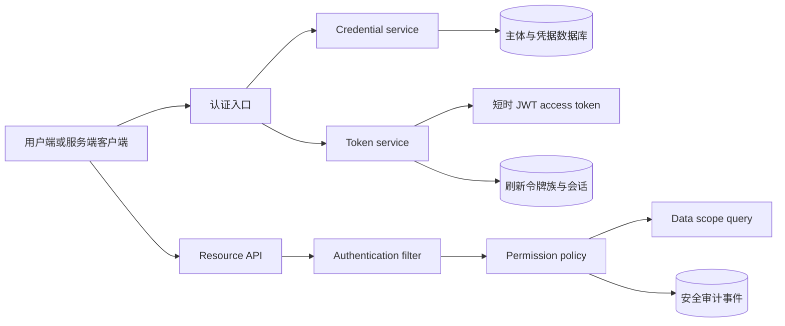

# Keystone Native 鉴权与授权开发计划

跨项目统一架构见 [`02-auth-authorization-parity-architecture.md`](02-auth-authorization-parity-architecture.md)。本文件同时记录 Native 本地实施任务和与 Keystone Phoenix 的跨项目验收要求。项目采用一次性重构，不保留旧接口、旧权限格式、旧响应封装或旧整数主键。

更新日期：2026-11-14。当前代码基线为 `e13dfe8`。`73d1bb9` 至 `6b1a586` 完成权限目录、UUID 主键、统一错误、资源范围、HTTP 安全策略、审计清理、限流告警和持久化 JWK 注册表；`7c0ec76` 完成 OIDC Authorization Code + PKCE；`a73073b` 完成 Native WebAuthn/Passkey；`3501045` 增加真实 MySQL 刷新、API Key 轮换和 MFA 恢复码并发验收；`6267559` 对齐 ORM 与 MySQL 最终列类型，并修复 WebAuthn 默认关闭时的 session key 启动条件；`0960a5e` 修复操作日志删除权限码并要求 WebAuthn 注册使用 AAL2 step-up；`53b3cac` 补齐非用户资源入口范围检查、修复 CDI 代理上的范围注解解析并增加真实 HTTP 越权测试；`196eaae` 为角色、菜单、配置、字典、岗位、公告、任务、审计和文件等管理命令建立显式 `AuthorizationContext`；`5df5b88` 将用户、部门和个人资料命令也接入该上下文；`3b0ec87` 增加 API Key 轮换计数和安全事件运营报告接口；`09be890` 增加 Flyway V56 owner 字段和公告/任务的 `SELF/OWNER` 数据过滤，覆盖越界读写、执行和混合删除回滚；`d62d40b` 删除认证响应中的重复旧 `token` 字段。当前 `./gradlew clean test --no-daemon` 为 169 项通过、0 项跳过；`./gradlew quarkusBuild -x test --no-daemon`、源码行数和 `git diff --check` 均通过。MySQL 8.4.13 已执行并重复验证 Flyway V55；V56 已加入 owner 字段、索引和外键迁移，并有迁移结构回归。`scripts/verify_v56_migration.sh` 已在隔离的 MySQL 8.4.13 数据库中验证空库首次执行、完整重跑、索引/外键缺失重跑和字段缺失重跑；四种场景均恢复为单列、单索引和单外键。真实启动健康检查无 Hibernate schema validation 错误。本地 OIDC provider、临时 TLS 终止代理、备份还原、应用进程数据库断开恢复、API Key 猜测限流、JWT key 轮换和单进程崩溃重启后的旧访问令牌恢复均已完成真实验收。主线已无 `is_admin` 字段。当前剩余公网 IdP、浏览器/硬件 Passkey、浏览器 CSRF/Cookie、多节点恢复、全部资源的真实 owner/member 数据过滤、导出/批量/异步范围、跨租户报表和旧代码清理；V56 的独立生产升级、真实生产数据恢复和发布窗口验证仍未完成。

当前结论：核心实现已完成，开发计划尚未全部完成，不能据此声明生产发布验收通过。服务层已完成显式 `AuthorizationContext` 改造；`09be890` 为公告和任务增加可验证 owner 字段，`d62d40b` 删除重复旧 token 字段，SELF/OWNER 列表、详情、更新、执行和混合删除回滚测试通过。报告接口和 owner 范围已有代码与定向 HTTP 证据，完整生产数据和跨租户报告验收仍未完成。全部资源的真实 owner/member 过滤、导出/批量/异步范围、V56 生产升级和真实数据恢复链路、浏览器 CSRF/Cookie 实际行为、浏览器或硬件 Passkey、真实生产 IdP/TLS、多节点恢复和旧代码清理仍属于未闭环条件。

## 跨项目统一主线

Native 与 Phoenix 分别实现，但必须遵守统一架构中的 Principal、权限、数据范围、令牌字段、错误分类和审计约定。两个项目只使用 `resource:action` 权限，角色只绑定权限目录 ID。

主键迁移先于后续业务实现：用户、角色、部门、菜单、权限、会话、令牌族、API Key、MFA 请求和安全事件统一使用 UUID。新业务实体使用 UUIDv7；权限目录和固定种子使用固定命名空间的 UUIDv5。外部接口使用规范小写连字符 UUID 字符串；Native 的 MySQL 使用 `BINARY(16)`，写入和按 ID 过滤使用参数侧 `UUID_TO_BIN(?, 0)`，文本结果使用 `BIN_TO_UUID(id, 0)`，不在过滤列上调用 `BIN_TO_UUID`。Phoenix 的 PostgreSQL 使用原生 `uuid` 类型。V50 在 clean-break 边界内按依赖逆序重建认证、MFA、服务主体和 API Key 表，删除旧文本身份并建立 `BINARY(16)` 外键；生产执行前必须完成备份。迁移成功后重跑只读取完成标记，不重复删除表。ORM 的 UUID 参数使用二进制绑定，原生 SQL 的写入和读取分别使用 `UUID_TO_BIN(..., 0)` 与 `BIN_TO_UUID(..., 0)`。

跨项目实施顺序为：公共接口冻结、UUID 主键迁移、角色授权重建、Phoenix API Key、Phoenix MFA/JWK、资源范围矩阵、接口统一和运行验收。每个阶段必须分别完成迁移、重复迁移、定向测试、全量测试、真实 HTTP 和数据库运行检查；静态编译不能替代运行证据。旧接口和旧字段直接删除，不增加兼容适配层。

本文中的“历史基线证据”和“当前实现证据”只用于识别需要替换的范围，不代表新系统已经完成。一次性重构从 U0 阶段重新实现和验收；现有实体、迁移、接口和测试只有在符合本设计后才能继续使用。

## 术语与边界

- **认证（Authentication）**：确认用户或机器凭据属于哪个主体。
- **授权（Authorization）**：根据主体、凭据范围、资源和动作决定是否允许操作。
- **用户会话（User session）**：用户登录后使用短时访问令牌和轮换刷新令牌。
- **API Key**：机器调用凭据。只保存哈希，支持范围、过期和撤销。
- **角色（Role）**：权限的管理分组。角色本身不直接代表数据范围。
- **权限（Permission）**：稳定的 `resource:action` 操作标识。
- **数据范围（Data scope）**：主体可以读取或修改哪些资源记录。

## 历史基线证据（不属于新系统设计）

现有代码使用 `@RolesAllowed("ADMIN")` 和 `@RolesAllowed({"USER", "ADMIN"})` 保护接口。`sys_permission` 主要用于菜单和角色展示，接口没有统一按权限码核验。`sys_role.data_scope` 与 `dept_scope` 已存在，但没有进入业务查询条件。

现有访问令牌有效期为两小时。令牌只包含用户名、用户 ID、角色和 `jti`，没有明确的 `aud`、`sid` 和权限范围。刷新令牌、访问令牌标识和会话状态共用 `sys_refresh_token`。登出接口允许匿名调用，并以请求体中的刷新令牌作为唯一输入。登录没有失败次数、账户锁定、MFA 或请求限流。

## 当前实现证据

截至当前分支实现，受保护资源已经使用 `@RequiresPermission` 和集中授权服务。用户接口已接入 `ALL`、`SELF`、`DEPARTMENT`、`DEPARTMENT_AND_CHILDREN`、`CUSTOM` 范围策略。API Key 已接入 Quarkus `HttpAuthenticationMechanism`，支持服务主体、范围交集、轮换、撤销、过期和最后使用时间节流。数据访问层已统一使用 Hibernate ORM with Panache；安全事件、登录审计、操作日志、限流、MFA、OIDC、WebAuthn、用户、角色、部门和管理资源已使用 ORM Repository。OIDC 服务端生成并保存 state、nonce 和 verifier，校验 RS256/JWKS、issuer、audience、`azp`、时间窗口和外部主体映射；WebAuthn 保存凭据公钥、算法、aaguid 和计数器，注册要求人类用户会话，登录签发 AAL2 会话。Native 默认关闭 WebAuthn；启用时要求明确 HTTPS/localhost origin、RP ID 和高熵 session key。

当前会话状态保存在 `sys_auth_session`，刷新令牌保留在 `sys_refresh_token` 作为轮换明细。访问令牌有效期为五分钟，并校验 `iss`、`sub`、`aud`、`jti`、`sid`、`iat`、`exp` 和 `permission_version`。权限版本变化、密码变更、用户禁用和会话撤销都会使受影响的访问令牌失效。

令牌签发失败时，登录和 MFA 登录会撤销刚创建的会话；刷新失败时会撤销刚轮换的会话，避免数据库中保留客户端无法使用的刷新状态。签名密钥配置错误仍应在启动或就绪检查阶段被发现。

当前新增了 MFA 第一版运行链路：`V39__mfa_foundation.sql` 建立 TOTP、恢复码和认证请求数据表，`V40__mfa_permissions.sql` 建立 `mfa:manage` 权限；`TotpService` 实现 RFC 6238 六位验证码、三步时钟窗口和时间步返回，`MfaSecretCipher` 使用 AES-256-GCM 保护 TOTP 密钥，`MfaRecoveryCodeService` 使用部署级 pepper 计算恢复码 HMAC，`MfaChallengeRepository`、`MfaSessionRepository` 和 `MfaRepository` 分别处理认证请求、会话认证强度、密文状态和一次性消费条件，`MfaService` 编排 enrollment、登录验证请求、恢复码和强制 MFA 策略。

新登录入口在密码正确且用户要求 MFA 时返回 `MFA_REQUIRED` 和不透明认证请求 ID，不创建会话或令牌；`POST /api/v1/auth/mfa/verify` 校验 TOTP 或恢复码后才创建会话和令牌。`POST /api/v1/auth/mfa/enroll`、`POST /api/v1/auth/mfa/enroll/verify` 提供管理员 enrollment，`PUT /api/v1/auth/mfa/policy/{userId}` 只允许对已完成 enrollment 的用户启用策略。API Key 被拒绝进入这些人类 MFA 路径。恢复码只在 enrollment 成功响应中返回一次，数据库保存 HMAC，不保存恢复码明文。

上述 MFA 代码已通过全量主源码和测试源码静态 `javac`，并通过固定向量和输入边界 smoke 检查。MFA 失败现在按主体和来源地址双维度限流，API Key、角色、用户、在线会话和 MFA enrollment/策略管理的敏感写操作已接入最近十分钟 AAL2 step-up 检查，恢复码轮换还要求当前密码。密码强度和账户锁定指数退避已接入用户创建及密码修改路径。JWT 不再使用仓库内公钥 fallback，签发必须配置外部密钥和 `JWT_KEY_ID`，访问令牌写入 `type=access`、`aal`、`amr`、`kid`。`GET /api/.well-known/jwks.json` 发布当前 RSA 公钥；当前实现支持通过 `JWT_JWK_KEYS` 发布多个重叠公钥，并在启用多 key 时要求 `JWT_VERIFY_PUBLIC_KEY_LOCATION` 指向 JWK Set 文件或 HTTPS JWK Set URL。安全事件已补充 `session_id`、批准范围和 `request_id`。

当前验证边界仍然明确：本地 MySQL 8.4.13 已完成 Flyway V55、健康检查、JWK 注册表、登录、刷新、旧令牌重放撤销、注销、非法 UUID 统一错误响应、资源范围矩阵、API Key 签发/业务访问/撤销、MFA TOTP/恢复码/step-up、OIDC 协议输入边界和 WebAuthn 路由启动验收；V56 已增加公告 `owner_id` 和任务 `created_by` 的索引、外键和重跑保护。`DatabaseConcurrencyIntegrationTest` 已证明刷新、API Key 轮换和 MFA 恢复码在真实 MySQL 下各只有一次成功；owner 范围真实 HTTP 测试证明不同主体只能读取和操作自己的公告/任务，混合删除在越界时回滚。备份还原、容器停止/恢复、应用进程在数据库断开时 fail-closed 并恢复、应用整进程崩溃重启后旧访问令牌恢复、API Key 猜测限流、ACTIVE/RETIRING key 轮换、临时 TLS 终止代理和本地 OIDC provider 均已通过。操作日志删除权限、WebAuthn 注册 AAL2 step-up、SecurityObservability 的审计范围和非用户资源入口拒绝矩阵已补齐并有回归测试。ORM schema validation 已通过。仍未执行公网 IdP、浏览器 CSRF/Cookie、真实浏览器/硬件 Passkey、多节点恢复、全部资源的真实 owner/member 过滤、导出/批量/异步范围和 V56 生产升级、真实数据恢复链路验收。

HTTP 安全策略已集中到 Quarkus 配置和 JAX-RS 过滤器：生产 profile 默认要求 HTTPS 并发送 HSTS，Docker Compose 本地入口显式关闭 HTTPS 强制以保持 HTTP 验收；CORS 默认关闭，启用时必须配置明确来源，禁止通配符来源配合凭据；API JSON 响应统一发送 `nosniff`、`DENY`、`no-referrer`、`Permissions-Policy`、`Cross-Origin-Resource-Policy` 和 `no-store`。安全事件清理按保留天数、最大事件数和单次批量执行，认证失败、限流阻断和清理结果提供运行期计数与审计读取接口。尚未完成真实生产 TLS 证书、反向代理链和浏览器 CSRF/Cookie 场景验收。

## 目标架构

认证入口只接受登录密码、刷新令牌和 `API_KEY` 三类凭据。用户访问令牌使用 RS256、五分钟有效期、`iss/sub/aud/jti/sid/iat/exp/scope` 标准声明。刷新令牌每次使用都轮换；重复使用旧令牌时撤销整个令牌族。密码变更、禁用用户、注销会话和权限版本变化都能使现有会话失效。

API Key 使用 `ks_live_<prefix>_<secret>` 格式。数据库只保存 SHA-256 哈希和前缀。明文只在签发响应中返回一次。每个 key 具有主体、名称、显式权限范围、创建者、过期时间、撤销时间和最后使用时间。API Key 默认通过 `Authorization: ApiKey <value>` 发送，服务端不把它转换成用户密码或刷新令牌。

授权分三层：接口层核验权限码，服务层核验资源动作，查询层追加数据范围条件。所有拒绝都记录主体、凭据类型、权限码、资源和结果；日志不记录令牌、密码或完整 API Key。

## 分阶段交付

| 阶段 | 交付 | 验收条件 |
| --- | --- | --- |
| P0 | 凭据边界、API Key 生命周期、失败限流和管理员 MFA 基线 | 无越权签发；明文只返回一次；撤销、过期和锁定立即生效 |
| P1 | 会话表与刷新令牌族、短时 JWT、登出和密码变更失效 | 轮换并发只能成功一次；旧令牌重用会撤销令牌族 |
| P2 | `resource:action` 权限拦截器和权限缓存失效 | 未授权返回 403；权限变更在一个请求周期内生效 |
| P3 | OIDC、WebAuthn、密钥轮换和 JWK 发布 | step-up 覆盖全部敏感操作；OIDC 使用 PKCE；公钥可轮换 |
| P4 | 安全运营与下线旧接口 | 事件、告警、恢复演练完成；旧接口和旧 token 字段已删除 |

## 产品接口草案

### 用户认证

- `POST /api/v1/auth/login`：输入用户名、密码、客户端标识和设备信息。成功返回 `accessToken`、`refreshToken`、`tokenType`、`expiresIn`、`refreshExpiresIn`、`sessionId` 和 `subject`。
- `POST /api/v1/auth/refresh`：只接受当前刷新令牌。成功后旧令牌立即失效并返回新令牌；旧令牌重用返回 `401`，并撤销同一令牌族。
- `POST /api/v1/auth/logout`：必须使用当前访问令牌。默认撤销当前会话；`all=true` 需要更高权限并撤销主体的全部会话。
- `POST /api/v1/auth/password`：需要当前密码或已验证的 MFA。成功后增加 `credential_version`，撤销全部会话和 API Key。
- `GET /api/v1/auth/sessions`、`DELETE /api/v1/auth/sessions/{id}`：查询和撤销当前主体的会话。管理员可以按主体查询，但必须记录审计事件。

### API Key

- `POST /api/v1/api-keys`：管理员或具有 `api-key:create` 权限的主体签发。请求包括 `name`、`scopes`、`expiresAt` 和可选的 `subjectId`。
- `GET /api/v1/api-keys`：只返回 ID、前缀、名称、范围、状态、创建时间、过期时间和最后使用时间。
- `DELETE /api/v1/api-keys/{id}`：撤销 key。撤销操作幂等，并记录创建者和操作者。
- 调用格式为 `Authorization: ApiKey <key>`。`<key>` 只在创建响应中返回一次。

### 授权

权限码采用小写的 `resource:action` 格式，例如 `user:read`、`user:update`、`session:revoke`、`api-key:create`。角色只绑定权限集合。接口、服务和数据查询使用同一个权限码；菜单只引用权限码，不参与安全判定。

### JWT 公钥发现

- `GET /api/.well-known/jwks.json`：公开返回当前外部 RSA 公钥的 RFC 7517 JWK Set。响应只包含 `kty`、`kid`、`alg`、`use`、`n` 和 `e`，公钥读取失败返回 `503`。缺少或非法的 `JWT_KEY_ID` 属于启动配置错误，应用应在就绪检查中失败。
- 当前实现默认发布一个配置 key，也支持通过 `JWT_JWK_KEYS` 以 `kid=location;kid=location` 配置多个重叠公钥，并使用 `JWT_JWK_CACHE_SECONDS` 控制 1 至 3600 秒的已校验快照缓存。启用多个 key 时，`JWT_VERIFY_PUBLIC_KEY_LOCATION` 必须指向包含全部公钥的 JWK Set 文件或 HTTPS JWK Set URL；继续使用单个 PEM 会在启动检查阶段失败。缓存过期后的读取、解析和 JWK 组装全部成功时才替换快照；失败时继续提供上一个有效快照，直到缓存过期后请求失败。持久化 key registry、旧 key 到期清理和旧 key HTTP 验收仍需后续实现。
- 新客户端只调用 `/api/.well-known/jwks.json` 获取公钥，不提供旧公钥路由。

## 数据模型变更

### 数据访问层选择

当前项目选择 **Quarkus Hibernate ORM with Panache**，采用 `PanacheRepository<Entity>` 模式。该模式基于 Hibernate ORM/JPA，保留实体与 Repository 的职责分离，适合现有 Quarkus CDI、MySQL、事务和 Native 构建环境。项目不引入 MyBatis，也不采用 Panache Active Record 模式。

Flyway 继续负责数据库结构迁移，Hibernate ORM 设置为不自动创建或修改表结构。新增业务数据访问代码不得直接注入 `DataSource`、拼接 SQL 或使用 `PreparedStatement`。只有 Flyway 迁移文件和经过单独记录的数据库特定并发操作可以保留原生 SQL。

第一阶段已将 `sys_security_event` 迁移到 `SecurityEventEntity` 和 `SecurityEventRepository`；登录审计已使用 `LoginLogEntity` 和 `LoginLogRepository`，操作日志已使用 `OperationLogEntity` 和 `OperationLogRepository`，登录、API Key 和 MFA 限流已分别使用 `LoginRateLimitEntity`、`ApiKeyRateLimitEntity`、`MfaRateLimitEntity` 及对应的 Panache Repository，API Key 主记录已使用 `ApiKeyEntity`、`ServiceSubjectEntity` 和对应的 Panache Repository，API Key 认证和签发权限读取已使用独立的用户、角色和权限 ORM 映射，会话已使用 `AuthSessionEntity`、`RefreshTokenEntity`、`RefreshTokenEventEntity` 和对应的 Panache Repository，MFA 会话状态已复用 `AuthSessionEntity`，MFA 认证请求、TOTP 状态和恢复码已使用 ORM Repository，OIDC 授权请求和外部身份映射已使用 `OidcAuthRequestEntity`、`OidcAuthRequestRepository`，WebAuthn 凭据已使用 `WebAuthnCredentialEntity` 和 `NativeWebAuthnUserProvider`，用户创建、认证、失败登录锁定、密码修改、用户资料与角色综合更新、用户删除、列表和范围查询、数据范围读取、权限读取、权限版本和登录元数据已使用 ORM 用户和授权 Repository，角色管理、部门管理、配置、字典、任务、菜单、通知和岗位管理已使用 ORM Repository。业务仓储不再直接使用 JDBC；剩余工作集中在真实外部身份、生产传输链和应用进程故障恢复证据。迁移期间不得在同一业务职责中新增两套持久化实现。

当前已新增 `sys_api_key`、`sys_auth_session`、MFA 基础表和相关用户字段。后续仍需要补充以下表或字段：

- `sys_auth_session`：当前实现包含 `id`、`user_id`、`client_id`、`approved_scope`、`refresh_family_id`、`refresh_expires_at`、`idle_expires_at`、`last_seen_at`、`revoked_at`、`mfa_verified_at`、`mfa_assurance` 和 `mfa_amr`；IP、User-Agent 摘要和设备名称仍待补充。
- `sys_refresh_token_event`：记录轮换、重用、撤销和失败原因，用于检测令牌族攻击。
- `sys_user.mfa_required` 和 `mfa_grace_until`：用于记录 MFA 强制策略和宽限期，当前仍待补充。
- `sys_mfa_rate_limit`：只保存主体和来源地址的哈希维度、窗口计数和阻断时间；V41 使用可重跑建表迁移。
- `sys_permission.effect` 和 `sys_subject_permission`：为显式拒绝和主体级例外留下边界；默认拒绝，显式拒绝优先于允许。
- `sys_security_event`：统一安全事件，替代登录日志和操作日志中重复的安全字段。

还需要增加 `sys_service_subject`、`sys_auth_client` 和 `sys_api_key_scope` 或等效的规范化关系。若第一版保持单租户，仍需在授权接口和数据访问层定义租户边界，避免后续直接复用用户 ID 作为跨租户隔离条件。

所有令牌哈希列建立唯一索引。状态变更和轮换在同一个数据库事务中完成，并使用行锁防止并发刷新成功两次。

## 实施任务清单

### P0：凭据基础（当前批次）

- [x] 建立 `sys_api_key` 迁移。
- [x] 生成高熵随机 API Key，只保存 SHA-256 哈希。
- [x] 返回一次明文、支持过期和撤销、更新最后使用时间。
- [x] 增加 `Authorization: ApiKey` 请求入口。
- [x] 将 API Key 身份接入 Quarkus `HttpAuthenticationMechanism`，避免只依赖 JAX-RS `SecurityContext`。
- [x] 增加服务主体和签发者范围模型，禁止用角色名称充当 scope。
- [x] 增加 API Key 列表、轮换、幂等撤销、过期上限和使用时间更新限速。
- [x] 按 IP 和用户名双维度限制登录失败请求，并在成功登录后清除计数。
- [x] 增加 API Key 按权限码的接口测试和日志脱敏测试用例；Quarkus/MySQL 签发、业务访问、撤销和过期运行验收已完成。
- [x] 增加失败登录、账户锁定指数退避、管理员 MFA 第一版运行边界和 MFA 主体/IP 双维度限流；API Key 轮换并发已通过，凭据猜测专项和应用进程故障验收仍待执行。

当前已增加密码策略、第五次失败起指数账户锁定、成功登录清零失败计数、密码更新重置锁定状态并递增 `credential_version`，并在新登录入口增加数据库限流。API Key 认证失败现在按来源地址和凭据摘要双维度限流，失败窗口只保存哈希键；成功认证只清理当前凭据桶，来源地址桶保留到窗口结束。`sys_security_event` 已统一记录 API Key 认证结果和权限拒绝结果，并保存非秘密 `credential_id` 和来源地址，事件不保存令牌、密码或完整 API Key。管理员 MFA 已完成第一版 TOTP enrollment、登录验证请求、恢复码、策略开关和主体/IP 双维度失败限流；生产运行验收仍未完成。

当前代码已完成 API Key 的统一 Quarkus 身份入口、服务主体回填、scope 格式和签发者权限交集、元数据列表、轮换、幂等撤销、操作日志记录、`last_used_at` 最小更新间隔、API Key 人类入口拒绝和真实 HTTP 生命周期验收。真实 MySQL 轮换并发已通过；凭据猜测专项、备份还原和应用进程故障验收仍待执行。

### P1：用户会话

- [x] 在刷新令牌表增加 `session_id`、`refresh_family_id`、客户端标识和空闲期限。
- [x] 增加 `sys_auth_session` 并把创建、轮换、撤销和访问令牌校验接入独立会话状态。
- [x] 使用 `sid`、`sub` 和 `aud` 发行五分钟 JWT。
- [x] 保持刷新令牌族绝对到期时间，并在重用时撤销整族。
- [x] 将刷新令牌绑定到客户端。
- [x] 将刷新令牌绑定到已批准的 scope/resource。
- [x] 增加失败计数和账户锁定。
- [x] 增加密码强度和指数退避。
- [x] 密码变更和禁用用户触发会话撤销。
- [x] 权限变更触发会话或权限版本失效。

P1 当前实现已完成独立会话状态、会话 ID、令牌族、空闲期限、绝对刷新期限、旧令牌重用撤销、刷新事件记录、五分钟访问令牌、客户端绑定、批准范围绑定、权限版本校验以及 `sub/aud/sid/jti` 声明。缺少 `jti` 的 JWT 现在会直接返回 `401`，访问令牌还必须对应活动会话。真实 MySQL 并发刷新已通过；应用进程断开后的自动重连仍待执行。

### P2：权限和数据范围

- [x] 新增 `@RequiresPermission` 拦截器和集中式 `AuthorizationService`，并迁移 API Key 管理接口。
- [x] 使用权限码拦截器和集中授权服务；角色只作为权限集合管理。
- [x] 迁移用户管理和角色管理接口到权限码。
- [x] 迁移在线会话和操作审计接口到权限码。
- [x] 把 `data_scope` 转为明确策略：`ALL`、`SELF`、`DEPARTMENT`、`DEPARTMENT_AND_CHILDREN`、`CUSTOM`。
- [x] 将同一范围策略推广到所有已登记资源；缺少 owner/member 关系的资源默认要求 `ALL` 或 `TENANT`，用户和部门继续使用查询过滤。
- [ ] 每个列表、详情、更新和删除接口补充跨部门越权测试；服务层命令已覆盖主要管理资源，剩余工作集中在全部查询层过滤和异步边界。

当前已增加统一 `DataScopeService`，并把用户接口的列表、详情、更新、密码、状态、删除、批量删除、导出和导入路径接入范围条件。`DataScopePolicy`、`RequiresDataScope` 和 `DataScopeInterceptor` 已为所有登记资源执行矩阵；`196eaae` 将角色、菜单、配置、字典、岗位、公告、任务、审计和文件的管理命令改为接收显式 `AuthorizationContext`，`5df5b88` 继续覆盖用户、部门和个人资料命令。缺失主体、错误权限、越界范围和伪造系统主体已有直接服务层拒绝测试。异步任务、真实 owner/member 关系和所有列表/详情/导出/批量查询的范围条件仍需后续定义和验收。
核心资源的新权限码已覆盖用户、角色、会话、审计、部门、字典、岗位、配置、菜单、任务、文件、个人资料、通知和日志资源。公开健康检查、验证码和公告列表继续使用 `@PermitAll`。授权决策和访问令牌签发的主体权限读取已使用 ORM 用户、角色和权限映射。权限缓存失效、显式拒绝和跨租户范围仍未完成；服务层命令边界已完成首轮改造，但不能替代查询层的数据过滤证据。

2026-11-14 已建立 Native 资源范围执行矩阵。`DataScopePolicy` 登记资源适用范围，`RequiresDataScope` 和 `DataScopeInterceptor` 在资源入口执行默认拒绝规则；`AuthorizationContext` 又在主要管理命令边界复核权限和范围。用户和部门继续由仓储查询条件执行 `ALL`、`TENANT`、`SELF`、`DEPARTMENT`、`DEPARTMENT_AND_CHILDREN`、`CUSTOM`；个人资料和 API Key 只允许 `ALL`、`TENANT` 或 `SELF`。角色、岗位、菜单、配置、字典、审计和会话没有稳定 owner/member 关系，要求 `ALL` 或 `TENANT`。文件、公告和任务当前没有可验证的 owner/member 字段，也采用 `ALL` 或 `TENANT`，直到领域模型补充关系。普通部门范围主体访问这些资源会返回 `403 data_scope_denied`，不会因为接口存在权限码而扩大访问范围。真实记录的 owner/member 过滤、导出、批量和异步任务范围仍未完成。

| 资源 | 支持范围 | 执行方式 | 当前入口 |
| --- | --- | --- | --- |
| `user` | `ALL`、`TENANT`、`SELF`、`DEPARTMENT`、`DEPARTMENT_AND_CHILDREN`、`CUSTOM` | 用户查询、详情和写入条件 | `UserResource`、`ApiKeyUserRepository` |
| `department` | `ALL`、`TENANT`、`DEPARTMENT`、`DEPARTMENT_AND_CHILDREN`、`CUSTOM` | 部门查询、父节点和目标检查 | `DepartmentResource`、`DepartmentRepository` |
| `profile`、`api-key` | `ALL`、`TENANT`、`SELF` | 当前主体关系检查 | `ProfileResource`、`ApiKeyResource` |
| `role`、`post`、`menu`、`config`、`dictionary`、`audit`、`session` | `ALL`、`TENANT` | 入口默认拒绝 | 对应 REST resource |
| `file`、`notice`、`job` | `ALL`、`TENANT` | owner/member 关系缺失时入口默认拒绝 | 对应 REST resource |

### 2026-11-14 V56 迁移重跑验收

`scripts/verify_v56_migration.sh` 创建独立的 MySQL 8.4.13 容器和临时数据库，启动当前应用让 Flyway 从空库执行至 V56，然后直接重跑 V56 SQL。脚本随后删除公告和任务的索引、外键，再重跑 V56；最后删除字段及其依赖对象，再次重跑 V56。每个场景都检查 Flyway V56 成功记录、`BINARY(16)` 字段、索引列数和外键数量。2026-11-14 四种场景均通过，脚本退出码为 0；验证结束后自动删除临时容器、网络和数据卷，未修改现有 Native MySQL 数据库。

该结果证明 V56 在隔离数据库中的首次执行、完整重跑和两类部分执行恢复具备可重复性。它不替代生产升级窗口、真实业务数据备份还原和生产代理链路验证。

### P3：多因素和外部身份

- [x] 完成管理员 TOTP 第一版：enrollment、登录验证请求、恢复码一次性消费、会话认证强度和强制策略开关。
- [x] 将 step-up 接入 API Key、角色、用户、会话和 MFA enrollment/策略管理敏感写操作。
- [x] 提供当前密码加 step-up 保护的恢复码独立轮换接口。
- [x] 要求外部 JWT 公钥和 `kid` 密钥标识，删除仓库内生产公钥 fallback。
- [x] 增加 OIDC 授权码 + PKCE；服务端生成并保存 `state`、`nonce` 和 verifier，校验 JWKS、RS256、issuer、audience、`azp` 和时间窗口。V53/V54 已完成外部身份映射和短期 verifier 存储。
- [x] 增加 WebAuthn/Passkey 注册和登录；V55 保存凭据公钥、算法、aaguid、计数器和 UUIDv7 用户关联，注册要求 step-up，登录签发 AAL2 会话。
- [x] 发布 JWK Set，使用外部 RSA 公钥和 `kid`，公钥不可用时返回 `503`。
- [x] 增加 `JWT_JWK_KEYS` 多 key JWK 发布和启动位置检查；启用多 key 时必须配置真正的 JWK Set 文件或 HTTPS JWK URL。V52 已增加 `sys_jwt_key_registry`、ACTIVE/RETIRING 状态、过期清理和标准 JWK HTTP 验收；真实密钥轮换演练仍待独立执行。

#### 管理员 TOTP 第一版实现和限制

当前第一版实现管理员 TOTP、一次性恢复码和登录验证请求。API Key 不参与人类用户 MFA。WebAuthn/Passkey 已作为独立 AAL2 登录入口实现。API Key、角色、用户、在线会话和 MFA enrollment/策略管理敏感写操作已经接入 step-up；恢复码轮换还要求当前密码，并在数据库事务内替换旧批次。

已追加 `V39__mfa_foundation.sql` 和 `V40__mfa_permissions.sql`，没有修改已执行迁移：

- `sys_user_mfa` 保存 `user_id`、TOTP 密文、随机 nonce、`key_version`、启用时间、失败计数、锁定时间和最近成功的时间步。TOTP 密钥使用 AES-256-GCM 加密；首版若不能接入 KMS，必须配置 32 字节 `MFA_MASTER_KEY`，并记录密钥版本和重新加密流程。
- `sys_mfa_recovery_code` 保存恢复码哈希、批次和消费时间。生成至少十个高熵恢复码，只在生成响应中显示一次。消费使用行锁和条件更新，保证并发请求只能成功一次。
- `sys_auth_challenge` 保存不透明认证请求 ID、主体、用途、客户端、过期时间、尝试次数和消费时间。认证请求有效期建议五分钟，只绑定密码已验证的主体和客户端，不保存密码、TOTP 明文或完整恢复码。
- `sys_auth_session` 增加 `mfa_verified_at` 和认证强度字段。现有用户默认不启用 MFA；迁移不能直接把 `admin` 设置为必须 MFA。

实现组件和接口顺序如下：

1. `MfaSecretCipher` 使用 AES-256-GCM 保存 TOTP 密文，密钥版本由配置提供；未配置主密钥时只在实际使用密文时失败。
2. `POST /api/v1/auth/mfa/enroll` 创建短期 enrollment 验证请求并返回一次性 TOTP 配置材料。
3. `POST /api/v1/auth/mfa/enroll/verify` 校验 TOTP 后启用 MFA，并返回一次性恢复码列表。
4. 密码正确且用户要求 MFA 时，`POST /api/v1/auth/login` 只返回 `MFA_REQUIRED` 和不透明认证请求 ID，不签发会话或令牌。
5. `POST /api/v1/auth/mfa/verify` 校验 TOTP 或恢复码后，才创建 `sys_auth_session`、刷新令牌和访问令牌，并写入 `mfa_verified_at`、认证强度和 `amr`。
6. `PUT /api/v1/auth/mfa/policy/{userId}` 只允许对已经完成 enrollment 的用户启用强制 MFA，并在策略变化后撤销该用户的会话。
7. API Key 被 `RejectApiKey` 拦截器拒绝进入登录、enrollment、MFA 验证和策略管理路径。

TOTP 使用 RFC 6238 的 30 秒时间步、六位数字和允许前后一个时间步的时钟偏差。相同时间步的重复使用必须失败。当前失败次数按主体和来源地址双维度计数并短时锁定；数据库只保存哈希后的维度键。密码变更、用户禁用、会话撤销和重新 enrollment 必须撤销相关认证请求。

API Key、角色、用户、在线会话、MFA enrollment/策略变更和恢复码轮换均已接入 step-up。恢复码轮换还必须提供当前密码。API Key 不能执行这些人类用户 MFA 管理路径。

实现验收必须证明：未完成 enrollment 的用户不获得强制 MFA 令牌；正确 TOTP 才能创建会话；错误、过期、错误客户端和重复认证请求统一失败；恢复码只能消费一次；同一时间步并发请求只有一次成功；密钥、恢复码和完整 `otpauth` 数据不出现在日志、错误响应或数据库明文。当前已完成单事务代码、固定向量、输入边界 smoke、MySQL 8.4 迁移、真实 HTTP 生命周期和恢复码并发消费验收；应用进程故障恢复和真实部署链仍未完成。

### P4：运营与发布

- [x] 增加安全事件基础指标、异常登录和 MFA/API Key 限流告警、事件容量限制和保留清理；运行指标通过 `GET /api/v1/monitor/security` 提供给 `audit:read` 主体。
- [x] 增加 API Key 轮换报告和按当前单租户范围筛选的安全事件运营报表（`3b0ec87`，定向 HTTP 测试 3 项通过；完整组合测试、真实生产数据和多租户验收仍待执行）。
- [x] 进行 MySQL 8.4 刷新、API Key 轮换和 MFA 恢复码并发验收；完成容器停止/恢复、迁移重复执行和 ORM schema validation 检查。仍需补应用进程断开后的自动重连、备份还原和真实密钥轮换演练。
- [x] 完成 MFA 因子消费的单事务实现，覆盖 enrollment、TOTP、恢复码和认证请求状态；真实 MySQL 并发消费已通过，应用进程断开后的恢复仍待执行。
- [x] 完成可信代理地址解析，默认使用连接远端地址，拒绝未验证的 `X-Forwarded-For` 链；真实 HTTP 注入和部署链验收仍待执行。
- [x] 增加 `JWT_KEY_ID`、签名私钥和公钥集合的启动检查；Quarkus 就绪状态和运行时签名错误验收仍待执行。
- [ ] 删除旧根路由、旧 token 字段、旧资源实现和无效测试。

## 迁移与回滚边界

一次性重构允许删除旧根路由、旧资源和旧字段。数据库迁移按 Flyway 版本追加；发布前备份用户和角色数据。若新认证链路验收失败，恢复应用版本或数据库备份，不增加兼容适配层，禁止直接修改已执行迁移。

## 发布前检查

- `./gradlew test` 使用 MySQL 8.4 实例运行。
- `./gradlew quarkusBuild -x test` 成功。
- 运行 API Key 的签发、使用、过期、撤销、权限不足和日志脱敏测试。
- 使用真实 HTTP 客户端验证登录、注销和 API Key 生命周期；Native 不包含管理界面，不以页面验收替代 API 验收。

## 设计审查结论

本设计可以作为重构方向，但当前版本还不能直接作为生产发布方案。目标架构的主线是合理的：短时访问令牌、刷新令牌轮换、API Key 哈希存储、权限码和数据范围分层。主体模型、客户端边界、权限继承规则和失败处理已经写入本文档；MySQL、并发和真实 HTTP 运行证据仍不完整。

设计等级：**有条件通过设计评审，禁止按当前文档直接发布**。P0、P1 和 P2 的阻塞项关闭后，再进入实现评审和发布前安全评审。

阻塞项如下：

1. 必须把人类用户、服务主体、API Key 和 OAuth 客户端分开建模。API Key 不能因为携带 `ADMIN` 字符串而获得管理员角色。
2. 必须使用 Quarkus 的 `HttpAuthenticationMechanism` 或等效的安全身份提供器接入 API Key。仅设置 JAX-RS `SecurityContext` 会让 REST 层和 Quarkus `SecurityIdentity` 的行为依赖执行顺序。
3. 必须先完成刷新令牌族的并发控制、重用检测和客户端绑定，再缩短 JWT 生命周期。只缩短访问令牌不能消除刷新令牌被窃取后的持续访问风险。
4. 必须保留登录失败计数、账户锁定、请求限流和管理员 MFA 第一版，并完成 MySQL 与真实 HTTP 运行验收。
5. 必须把权限码落实到每个接口、服务方法和查询条件。历史 `@RolesAllowed` 代码不属于新实现，源代码中不得保留该注解。
6. 必须继续补齐 API Key 的过期、审计和并发运行测试；列出、轮换、范围上限和一次性明文已经有实现与静态接口测试。
7. 必须在受信反向代理配置明确后才启用 `X-Forwarded-For` 的 MFA 来源限流；部署直接暴露应用端口时，应使用连接远端地址，并对无法解析的地址采用独立、可观测的处理策略。
8. enrollment、恢复码批次替换、TOTP 接受和认证请求消费已经放入同一事务；仍必须完成 MySQL 并发和故障注入验收，证明失败时不会留下部分状态。
9. `JWT_KEY_ID`、签名私钥和公钥位置已经接入启动检查；仍必须通过 Quarkus 启动和就绪验收，证明配置错误不会创建不可用会话或轮换出客户端无法使用的新刷新令牌。

## 必须先确定的架构决策

### 主体和客户端

系统至少包含两类主体：人类用户和服务主体。服务主体没有交互式密码，不继承某个管理员用户的会话。每个 API Key 必须归属于一个服务主体；如果第一版暂时不引入独立服务主体，必须明确记录 `subject_type=USER`，并禁止 API Key 执行密码修改、MFA 修改、主体删除和 API Key 管理操作。

客户端分为浏览器客户端、受控后端客户端和内部任务客户端。浏览器客户端使用后端会话或 OAuth 授权码 + PKCE。外部客户端不使用用户名密码直接换取令牌。受控后端客户端使用 API Key、私钥 JWT 或 mTLS；选择哪一种由部署边界和密钥保管能力决定。

请求只允许一种认证凭据。服务端拒绝同时出现 `Bearer`、`ApiKey`、Cookie 或其他认证头的请求。令牌不能放在 URL 查询参数、日志字段或重定向地址中。生产环境强制 HTTPS，并设置安全的 CORS、缓存和响应头策略。

### 用户访问令牌

`sub` 使用稳定的主体 ID。资源服务必须同时校验 `iss`、`aud`、`exp`、`iat`、`jti`、令牌类型和签名算法。访问令牌头部使用 `kid`；密钥轮换期间保留旧公钥到所有旧令牌过期。

建议的令牌配置为：访问令牌 5 分钟，刷新令牌绝对期限 14 天，非活动期限 24 小时。`scope` 是权限码的空格分隔集合；角色不直接放入资源服务的授权判断。需要实时撤销时，通过 `sid`、主体凭据版本和短 TTL 缓存核验会话状态。

### API Key

API Key 的有效权限为：`请求范围 ∩ 签发者可授予范围 ∩ 主体当前权限`。服务端拒绝未知权限、管理员角色名称和超出签发者权限的范围。角色名不能作为 API Key scope。

每个 key 保存 `id`、`subject_id`、`created_by`、`name`、`prefix`、`secret_hash`、`scopes`、`created_at`、`expires_at`、`last_used_at`、`revoked_at`、`rotated_to` 和撤销原因。明文只返回一次。签发接口必须校验最长期限、范围数量、范围长度和名称长度。必须支持列出元数据、立即撤销、主动轮换和短暂重叠期；轮换后旧 key 只允许在明确的宽限时间内使用。

API Key 认证成功后创建统一的 `SecurityIdentity`，身份属性必须包括主体 ID、凭据 ID、凭据类型、权限范围和会话状态。认证失败统一返回 `401`，权限不足返回 `403`。`last_used_at` 应使用可配置的最小更新间隔或异步聚合，避免每个请求都写数据库。

### 授权决策

授权服务使用默认拒绝策略。决策输入为主体、凭据、权限码、动作、资源 ID、租户 ID 和请求上下文。权限来自角色绑定、主体直接授权和 API Key scope；显式拒绝优先于允许。授权服务不能根据前端菜单、URL 名称或用户提交的角色字符串做决定。

数据范围必须在数据访问层落实。每个列表、详情、更新、删除、导出、批量操作和异步任务都必须调用同一个范围构造器。单租户部署也应在模型中保留 `tenant_id` 的边界，否则未来多租户迁移会扩大越权风险。

### 故障处理

认证数据库不可用、权限查询超时、缓存状态不确定或密钥状态无法确认时，受保护请求必须失败关闭并返回统一的 `503` 或 `401`，不能回退到 JWT 中的旧角色或前端传入的权限。健康检查和就绪检查要分别报告数据库、迁移、签名私钥和公钥集合状态。

## 完备性验收矩阵

| 领域 | 必须证明的行为 | 当前状态 |
| --- | --- | --- |
| 密码认证 | 弱密码拒绝、失败退避、账户锁定、用户枚举防护、密码变更撤销会话 | 部分完成：密码策略和指数退避已实现，用户枚举防护及运行验收未完成 |
| JWT | `iss/aud/sub/jti/sid/iat/exp/kid` 校验、算法白名单、时钟偏差、密钥轮换 | 已实现并完成 JWK Set、持久化 registry、未知 `kid` 拒绝、旧 key 保留/过期移除和 HTTP 验收；公网密钥服务未接入 |
| 刷新令牌 | 原子轮换、并发单成功、重用检测、整族撤销、客户端绑定、空闲过期 | 已实现；真实 MySQL 并发刷新、应用进程数据库断开恢复和整进程崩溃重启后的旧访问令牌恢复通过，多节点恢复仍待执行 |
| API Key | 服务主体、范围交集、一次性明文、过期、撤销、轮换、审计、限速 | 已实现；真实 MySQL 轮换并发和猜测限流通过，轮换计数报告已实现并通过定向 HTTP 测试，完整组合和生产运营验收仍待执行 |
| 授权 | 默认拒绝、权限码、显式拒绝、实时失效、服务层和查询层复核 | 部分完成：权限码、权限版本失效和主要管理命令的 `AuthorizationContext` 已实现；全部服务命令、显式拒绝和查询层复核仍未完成 |
| 数据范围 | ALL、TENANT、SELF、DEPARTMENT、DEPARTMENT_AND_CHILDREN、CUSTOM、OWNER、MEMBER 以及导出和批量操作无越权 | 部分完成：用户资源和非用户资源入口拒绝已接入，用户/部门命令已补主体范围检查；真实资源数据过滤、owner/member 关系、导出/批量/异步操作仍未完成 |
| MFA | 管理员强制 MFA、恢复码、重新验证和敏感操作升级认证 | 已实现并完成真实 HTTP、MySQL 并发恢复码消费和单事务验收；应用进程故障恢复仍待执行 |
| OIDC | Authorization Code + PKCE、state/nonce、JWKS、issuer/audience/azp/时间窗口、subject 映射 | 已实现并通过本地 provider 的真实 HTTP 重定向、PKCE、失败模式和回放拒绝；公网 IdP 未执行 |
| WebAuthn | challenge、RP ID/origin、凭据公钥、计数器、AAL2 会话和 API Key 拒绝 | 已实现并完成 MySQL 迁移、启动、路由、注册 AAL2 step-up 和配置失败验收；真实浏览器/硬件仪式未执行 |
| Web 与传输 | HTTPS、CORS、CSRF、Cookie 属性、浏览器存储、缓存控制 | 生产 HTTPS/HSTS、CORS、统一安全响应头和临时 TLS 代理链已验证；浏览器 CSRF/Cookie 和生产证书链仍待执行 |
| 审计 | 签发、使用、失败、撤销、重用、权限拒绝和管理员操作可追踪 | 部分完成：API Key 认证、权限拒绝和非秘密 credential ID 已记录；事件按保留时间和总量清理，安全事件运营报告已实现并通过定向 HTTP 测试；完整凭据生命周期和生产数据验收未完成 |
| 运维 | 密钥托管、轮换、备份恢复、告警、限流、数据库故障行为 | 部分完成：认证失败阻断告警、限流、事件清理、迁移重复执行、备份还原、容器恢复、进程崩溃重启、进程存活恢复、key 轮换和运营报告接口已验证；完整组合测试、多节点恢复和真实运营演练仍待执行 |
| 旧代码清理 | 旧根路由、旧 token 字段、旧测试和旧资源全部删除 | 未完成：一次性重构阶段统一删除 |

## 审查后的阶段调整

原计划中的 MFA、限流和 API Key 完整生命周期排得过晚。调整为：P0 完成主体边界、API Key 安全基线、登录失败防护和管理员 MFA；P1 完成会话与刷新令牌；P2 完成权限码和数据范围；P3 完成 OIDC、WebAuthn 和密钥轮换；P4 完成审计、告警、恢复演练和旧接口删除。

P0 代码仍必须补充 API Key 猜测、并发撤销和数据库故障运行测试。`GET /api/v1/api-keys`、主动轮换、幂等撤销、过期时间上限、未知 scope 拒绝、scope 与主体权限交集、服务主体归属、审计事件和日志脱敏已有实现或静态接口测试；运行证据完成前不能标记为 P0 完成。

## 发布前新增检查

- 运行并发刷新、并发撤销、API Key 猜测、权限变更和数据库不可用测试。
- 使用独立测试主体验证跨部门、跨主体、跨租户和服务主体边界。
- 验证所有导出、批量操作、异步任务、文件下载和后台任务都执行数据范围检查。
- 生成安全评审记录，列出每个未完成项的责任人、提交、证据和发布决定。
